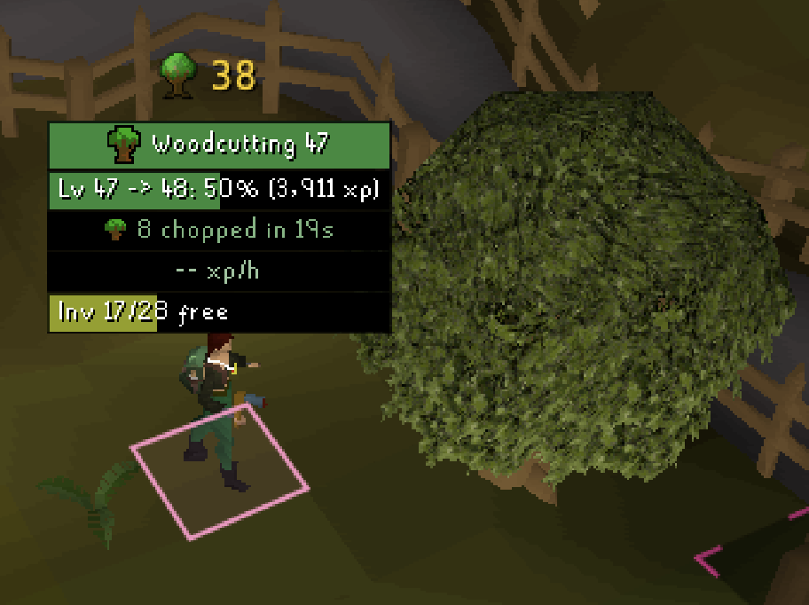
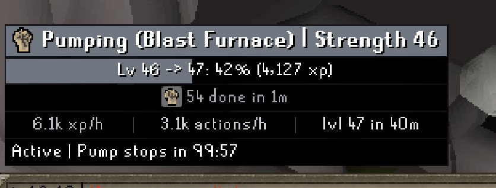
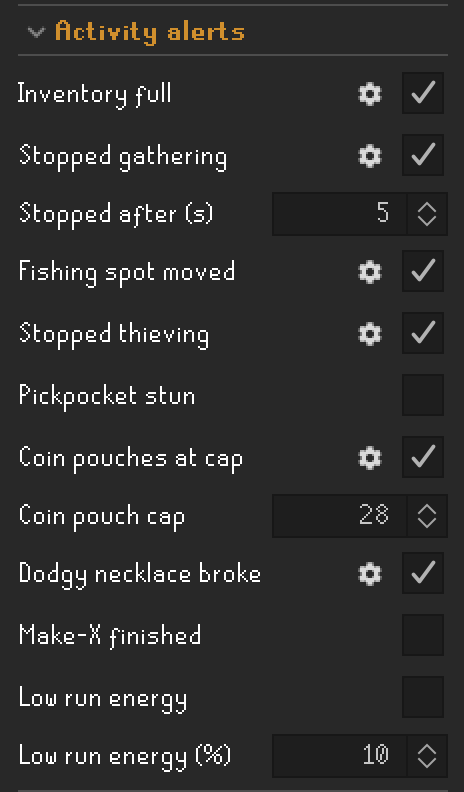
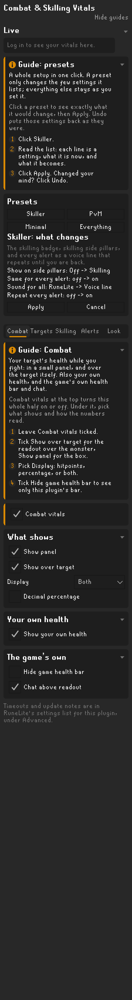
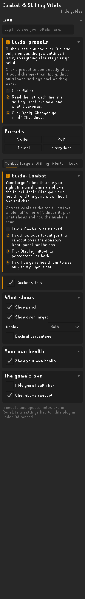

# Combat & Skilling Vitals

Two halves, one look. **Combat**: your opponent's health drawn on them, players
included, and honest about how exact the number is. **Skilling**: a badge over
your head with your level, boost timer, XP to the next level, inventory and
log basket space, plus alerts for the moments you would miss.

  

**Getting started**

1. Install **Combat Vitals** from the Plugin Hub.
2. Open its settings (the wrench in RuneLite's sidebar, then the plugin).
3. Attack something, or start fishing, chopping, mining or thieving.

Every setting, the troubleshooting list and building from source are in
[SETUP.md](SETUP.md).

---

## Combat

### Health on the target

The readout is drawn over whoever you are fighting, NPC or player, and over you
in the same style. The colour slides from green to red as health drops.

  

### How exact the number is

The game sends opponent health as a bar, not a number. NPCs with 30 max HP or
less are exact; players are within one or two hitpoints, and the bar lags a
couple of ticks after they eat. Your own health is always exact.
The measurements: [docs/accuracy.md](docs/accuracy.md).

### NPC aggression timer

When an NPC attacks you without you fighting it, a small corner panel counts down
ten minutes (`Aggressive for 9:54`), then says `NPCs are no longer aggressive
here`. Leaving the 21x21 area, hopping worlds or changing floors resets it. The
area's edge on the ground is an option (`Aggression area lines`, off by default;
RuneLite's own NPC Aggression Timer plugin draws the same lines). This is the
plugin's own timer; it reads nothing from that plugin. The start trigger and the
area's centre are our reading of the rule and have not been checked in game.

### Side pillars

Optional bars beside the inventory, where RuneLite's Status Bars draws: your
target's health in combat, XP and inventory fill while skilling. They never
overlap Status Bars.

| Skilling | In combat |
|:---:|:---:|
|  |  |

The XP pillar shows the percent to your next level at the top and your level
at the bottom.

  

## Skilling

### The skilling badge

Work a fishing spot, tree, rock, stall or altar and the badge appears over your
head in the skill's colour: boosted level and the seconds until the boost
drops, XP to the next level, what you have gathered this session and per hour,
and your free slots. Once you stop it says `Not fishing` for a while.

| Thieving | Mining |
|:---:|:---:|
|  |  |

### What you can catch

On a fishing spot the inventory line shows every fish the method can give.
Fish above your level are dimmed with the level they need.

  

### Inventory, log basket and fish barrel

`Inv 26/28 free` on a bar that runs green to red as you fill it. Tools, bait
and stackables do not count as space you can fill. A carried log basket, fish
barrel, coal bag or essence pouches gets its own line, and can count as free
space so *Inventory full* waits for it too. An open log basket also says what
is inside it (`9 Yew logs, 3 Oak logs`, from its Check text), and forestry kit
leaves gathered since login are counted after it.

### Sessions and events

*Reset session* in the sidebar's Skilling tab zeroes the count and rates now;
*Auto-reset on a new activity* (off by default) does it when you move from yew
logs to maple logs, or to another skill, and puts the finished session's summary
in the chat. A Forestry event is named when it starts and, when it ends, the
chat says what you earned in it (experience and known rewards). *Mining and
fishing events* (off by default) alerts on a gem found while mining and a clue
bottle while fishing. The sidebar's *Overlays* card switches each overlay, or all
of them, on and off; it is the same setting as in RuneLite's list.

  

### Blast Furnace pump

Operate the pump and the badge counts your Strength XP and pumps, and says how
long until the pump stops by itself and until you would be logged out for
being idle. It also warns when you are on a world that isn't a pumping world,
when no one is stoking the stove, and when the stove's coke runs low.

| Pumping | A problem to fix |
|:---:|:---:|
|  |  |

### Activity alerts

RuneLite notifications for: inventory full, stopped gathering (not when you
walk off, bank or drop on purpose), fishing spot moved, stopped thieving, coin
pouches at cap, dodgy necklace broke, and optionally Make-X finished and low
run energy. Each alert can have its own sound or a voice line
(*"You've stopped chopping yew logs."*), and can repeat softly until you are
back.

  

## Sidebar panel

The plugin has its own button in RuneLite's sidebar (a small health bar over
a skilling bar). It holds every setting from RuneLite's settings list, the
same settings with the same values, laid out to be easier to find: presets at
the top, then five tabs. Change something in either place and the other shows
it. Timeouts and update notes stay in the settings list, under Advanced.

The screenshots are rendered from the real panel by `./gradlew screenshots`
(`VitalsSidePanelShots`).

### Presets

A whole setup in one click. A preset only changes the few settings it lists;
everything else stays as you set it. Click a preset to see exactly what it
would change, then Apply. Undo puts those settings back as they were.

| Preset | What it sets |
|---|---|
| Skiller | Skilling vitals and the skilling badge on, skilling side pillars, every alert as a Voice line that repeats until you are back |
| PvM | Combat vitals on: readout over the target, the panel, your own health, NPC targets, the stat comparison, the combat side pillar |
| Minimal | Just the health bar over your target: no panel, no own health, no stat comparison, no side pillars, Skilling vitals off |
| Everything | Both halves on: readout, panel, your own health, the stat comparison, the skilling badge, both side pillars |

Walkthrough: click Skiller, read the list (each line is a setting, what it is
now, and what it becomes), click Apply. Changed your mind? Click Undo.

### Combat tab

Your target's health while you fight: in a small panel, and over the target
itself. Also your own health, and the game's own health bar and chat. Combat
vitals at the top turns this whole half on or off.

1. Leave Combat vitals ticked.
2. Tick Show over target for the readout over the monster, Show panel for the box.
3. Pick Display: hitpoints, percentage, or both.
4. Tick Hide game health bar to see only this plugin's bar.

### Targets tab

Who gets a readout: monsters, players, and how big targets like bosses show.

1. Tick NPC targets for monsters; Player targets for PvP.
2. Set Big target is to Bosses only, then Big targets to Both for hitpoints and percent on bosses.

### Skilling tab

A badge over your head while you fish, cut, mine, thieve, runecraft or hunt:
XP to level, inventory, catches, boosts, and the next fishing spot. Skilling
vitals at the top turns this whole half on or off.

1. Leave Skilling vitals and Skilling badge ticked.
2. Untick any skill you do not want a badge for.
3. Under Rows, untick rows you do not read; Badge layout on the Look tab makes it smaller.
4. Once you stop: choose how long the badge stays after you stop.

### Alerts tab

A notification when something needs you: inventory full, you stopped
gathering or thieving, the fishing spot moved, the Blast Furnace pump and more.
Each alert is a card, folded to its name: open it to tick it on or off, and
**Test** plays it as it is set up now. **Same for every alert** gives them all
one sound, volume and repeat (sound packs included); untick it and each alert's
own sound, volume and Repeat show in its card. Every sound starts as
RuneLite's own; voice lines play only for the alerts you set to Voice line.

1. Tick Same for every alert.
2. Pick Voice line as the sound and set the volume, e.g. 40.
3. Tick Repeat every alert if you want it again until you are back.
4. Open Inventory full and click Test to hear it.

### Look tab

How things look: the readout's style and position, health colours, the badge's
size, place and colours, and the side pillars. The preview at the top redraws
as you change things: the health colours as a bar fading from full to empty,
and where the skilling badge sits for its position, offset and size. It is a
sketch, not the game's own drawing.

1. Pick a Style for the readout over your target.
2. Change the three health colours; the preview bar shows the fade.
3. Move the badge with Badge position and Badge offset; the preview shows where.
4. Side pillars: pick Combat, Skilling or Both.

## Privacy

When you attack a player, their name is sent to Jagex's own hiscores to look up
their Hitpoints level, once per opponent, cached for an hour. Turn it off with
*Targets → Look up player hitpoints*. Nothing else leaves your machine.

## Credit and licence

The health recovery is derived from RuneLite's `OpponentInfoOverlay`
(BSD-licensed). This plugin is BSD 2-Clause: see [LICENSE](LICENSE).
