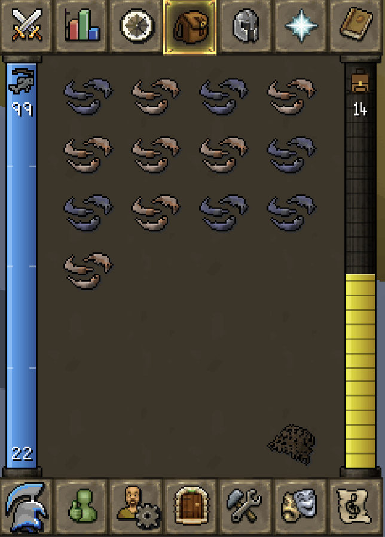

# Combat & Skilling Vitals

Two halves, one look. **Combat**: your opponent's health drawn on them, players
included, and honest about how exact the number is. **Skilling**: a badge over
your head with your level, boost timer, XP to the next level, inventory and
log basket space, plus alerts for the moments you would miss.

  

**Getting started**

1. Install **Combat Vitals** from the Plugin Hub.
2. Open its settings (the wrench in RuneLite's sidebar, then the plugin).
3. Attack something, or start fishing, chopping, mining or thieving.

Every setting, the troubleshooting list and building from source are in
[SETUP.md](SETUP.md).

---

## Combat

### Health on the target

The readout is drawn over whoever you are fighting, NPC or player, and over you
in the same style. The colour slides from green to red as health drops.

  

### How exact the number is

The game sends opponent health as a bar, not a number. NPCs with 30 max HP or
less are exact; players are within one or two hitpoints, and the bar lags a
couple of ticks after they eat. Your own health is always exact.
The measurements: [docs/accuracy.md](docs/accuracy.md).

### Side pillars

Optional bars beside the inventory, where RuneLite's Status Bars draws: your
target's health in combat, XP and inventory fill while skilling. They never
overlap Status Bars.

| Skilling | In combat |
|:---:|:---:|
|  |  |

## Skilling

### The skilling badge

Work a fishing spot, tree, rock, stall or altar and the badge appears over your
head in the skill's colour: boosted level and the seconds until the boost
drops, XP to the next level, what you have gathered this session and per hour,
and your free slots. Once you stop it says `Not fishing` for a while.

| Thieving | Mining |
|:---:|:---:|
|  |  |

### What you can catch

On a fishing spot the inventory line shows every fish the method can give.
Fish above your level are dimmed with the level they need.

  

### Inventory, log basket and fish barrel

`Inv 26/28 free` on a bar that runs green to red as you fill it. Tools, bait
and stackables do not count as space you can fill. A carried log basket, fish
barrel, coal bag or essence pouches gets its own line, and can count as free
space so *Inventory full* waits for it too.

  

### Activity alerts

RuneLite notifications for: inventory full, stopped gathering (not when you
walk off, bank or drop on purpose), fishing spot moved, stopped thieving, coin
pouches at cap, dodgy necklace broke, and optionally Make-X finished and low
run energy. Each alert can have its own sound or a voice line
(*"You've stopped chopping yew logs."*), and can repeat softly until you are
back.

  

## Privacy

When you attack a player, their name is sent to Jagex's own hiscores to look up
their Hitpoints level, once per opponent, cached for an hour. Turn it off with
*Targets → Look up player hitpoints*. Nothing else leaves your machine.

## Credit and licence

The health recovery is derived from RuneLite's `OpponentInfoOverlay`
(BSD-licensed). This plugin is BSD 2-Clause: see [LICENSE](LICENSE).
