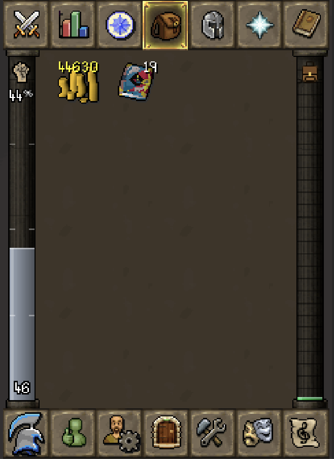
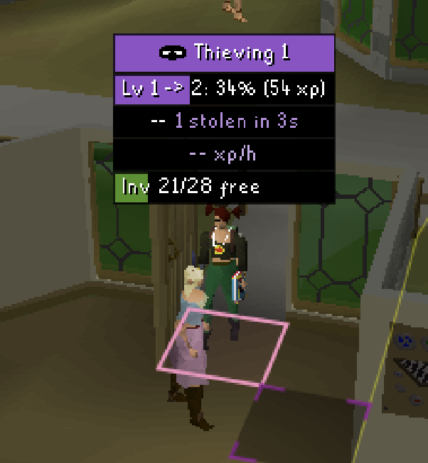
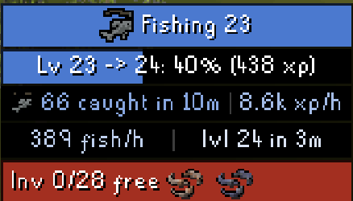
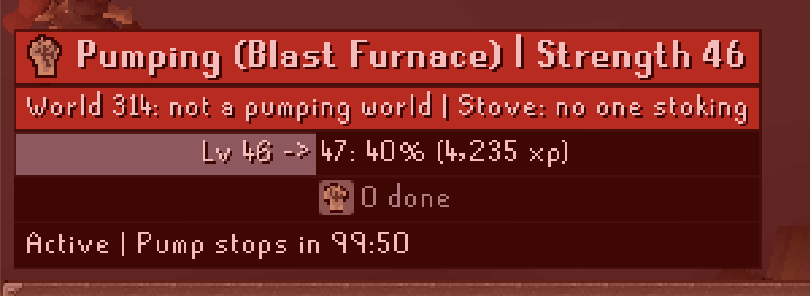
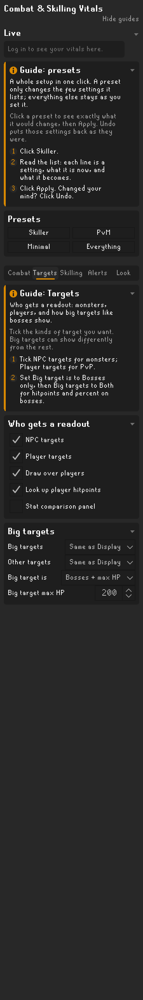
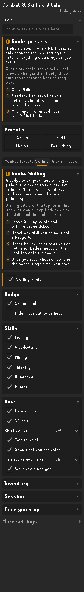
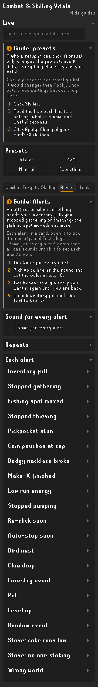
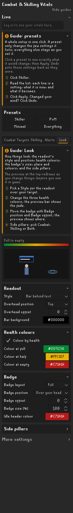

# Combat & Skilling Vitals

I had so many plugins installed to track opponent health, skilling progress,
containers, aggression timers, and AFK alerts, and I've been having fun
developing plugins of my own. Now that I can build them how I want them, I went
ahead and combined the ones I reach for every day into fewer plugins—sharing one
consistent look, one sidebar panel, and one alert and sound system.

Both halves (**Combat vitals** and **Skilling vitals**) have their own master
switches at the top of the settings, so you can run the whole setup together or
turn on just the pieces you like.

  

**Getting started**

1. Install **Combat & Skilling Vitals** (listed under `combat-vitals`) from the Plugin Hub.
2. Open its sidebar panel (the health-and-skilling bar icon in RuneLite's sidebar) or its settings list.
3. Pick a preset (*Skiller*, *PvM*, *Minimal*, or *Everything*), or jump straight into combat or skilling.

Every setting, the troubleshooting list and building from source are in
[SETUP.md](SETUP.md).

---

## Covers these plugins

If you want to run fewer plugins and configure everything in one place, Combat
& Skilling Vitals covers the jobs below in one matching style. Everything plays
nicely if you prefer to keep any of them enabled alongside it.

### Plugin Hub plugins

| Plugin | What Combat & Skilling Vitals covers |
|---|---|
| [NPC Health Text](https://runelite.net/plugin-hub/show/npc-health-text) | Overhead hitpoints and percentage text positioned above NPCs (*Top*, *Middle*, or *Bottom* plus pixel offset), extended to PvP player targets and your own character. |
| [Monster HP Percentage](https://runelite.net/plugin-hub/show/monster-hp-percentage) | Monster health as a percentage (with optional decimals), hitpoints, or both, with separate display rules for bosses and high-HP NPCs versus regular monsters. |
| [Inventory Notifier](https://runelite.net/plugin-hub/show/inventory-notifier) | Full-inventory alerts while gathering or thieving, paired with a green-to-red inventory capacity bar and optional open log basket / fish barrel space counting. |
| [Fish Barrel](https://runelite.net/plugin-hub/show/fish-barrel) | Tracks fish barrel and fish sack barrel contents from game messages and Fill/Empty actions, alongside log baskets (with per-log breakdown), coal bags, and essence pouches. |
| [GP Per Hour](https://runelite.net/plugin-hub/show/gp-per-hour) *(container tracking)* | Covers the skilling container capacity tracking (log basket, fish barrel, and coal bag fill states); does not track GP profit or supply cost per trip. |
| [Idle Alarm](https://runelite.net/plugin-hub/show/idle-alarm) | Gentle repeating sound or spoken voice alerts when gathering, thieving, Make-X, or Blast Furnace pumping stops, silencing as soon as you click, press a key, or resume XP. |
| [Clue Scroll Notifier](https://runelite.net/plugin-hub/show/clue-scroll-notifier) | Skilling clue drop alerts (naming the tier for clue nests, geodes, bottles, and scroll boxes) with custom WAVs, bundled sound packs, or spoken voice lines. |
| [Sound Alerts Expanded](https://runelite.net/plugin-hub/show/sound-alerts-expanded) | Custom WAV files per alert in `.runelite/plugin-data/combat-vitals/sounds/`, three synthesised sound packs, offline-rendered voice lines, and timed sidebar muting for skilling and activity alerts. |

### Built-in RuneLite plugins

| Built-in plugin | How Combat & Skilling Vitals covers or works with it |
|---|---|
| **Opponent Information** | Corner target-health panel, single-opponent player Hitpoints lookup (with an opt-out toggle), and PvP combat stat comparison; auto-hides its own corner panel while Opponent Information is on. |
| **NPC Aggression Timer** | 10-minute unprovoked-aggression countdown in the corner panel and optional 21x21 safe-zone lines on the ground; independent of the built-in plugin's custom area calibration. |
| **Status Bars** | Vertical side pillars beside the inventory for target health, XP progress, and inventory/open-container fill; stacks to the left of Status Bars when both are enabled so bars never overlap. |
| **Boosts Information** | Preserve-aware stat boost drain timer, boost source label, and optional boost-drop alert built right into the skilling badge. |
| **Idle Notifier** | Activity-aware stopped-gathering, fishing-spot-moved, stopped-thieving, Make-X, low-run-energy, and pump idle-logout alerts that stay quiet when you walk off, bank, or drop items on purpose. |
| **Fishing, Woodcutting, Mining, Agility & Runecraft** | Unified overhead/spot/draggable badge across 17 skills with session counts, XP/h, actions/h, time to level, catchable fish icons, Forestry event reward summaries, bird nest alerts, agility laps/marks, and degraded essence pouch capacities. |

---

## Combat

### Target and own health readout

- **Over the target and in a corner panel:** draws health over whoever you are
  fighting—NPC or PvP player—and optionally in a corner box (*Show panel*), with
  your own exact Hitpoints from the orb drawn over your character while engaged
  (*Show your own health*, also shown while pickpocketing).
- **Three styles and custom gradient:** *Bar behind text*, *Text above health
  bar*, or *Text only*; *Top*, *Middle*, or *Bottom* anchor plus pixel offset;
  three-stop green-amber-red health fade with alpha; configurable post-combat
  timeout (1–60 seconds).
- **Bosses vs regular monsters:** *Big targets* and *Other targets* let you show
  percentage (or both) on bosses and high-HP NPCs (default 200+ HP or any NPC
  using the game's boss HUD) while keeping hitpoints on everyday monsters.
  Stands down behind the native boss HP bar by default (*Hide behind boss HP
  bar*).
- **PvP player lookups and stat comparison:** optional single-target hiscores
  Hitpoints lookup (*Look up player hitpoints*, cached for an hour, degrades
  cleanly to percentage for unranked players) and an optional **Stat comparison
  panel** comparing your combat stats against your opponent's from the same
  cached lookup.
- **Game health bar swap and overhead chat:** *Hide game health bar* (off by
  default; [docs/native-hp-bar.md](docs/native-hp-bar.md)) replaces the native
  green-and-red bar on you and your target with the readout while redrawing
  plain bars for nearby actors so no bar goes missing (restoring Interface
  Styles' HD bars when turned off). *Chat above readout* (on by default;
  [docs/overhead-chat.md](docs/overhead-chat.md)) lifts overhead chat above the
  readout or skilling badge so talk is never covered.

  

### How exact the number is

The game sends opponent health as a bar ratio rather than an exact integer. NPCs
with 30 max HP or less resolve to the exact hitpoint; higher-HP targets and
players sit within a small hitpoint band, and the observed bar lags a couple of
ticks after healing. Your own health is always exact. Full measurements:
[docs/accuracy.md](docs/accuracy.md).

### NPC aggression timer

When an attackable NPC turns on you without you fighting it, a small corner
panel counts down ten minutes (`Aggressive for 9:54`), then switches to `NPCs
are no longer aggressive here`. Leaving the 21x21 tolerance area, hopping
worlds, changing floors, or logging out resets it. Drawing the 21x21 boundary on
the ground (*Aggression area lines*) is available and off by default.

### Splashing mode

For AFK Magic training (off by default, under *Targets*). While you cast a
combat spell at an NPC (autocast or manual spell-on-NPC), a compact overlay
shows your equipped **Magic attack bonus** and your **chance to hit** that NPC
using the OSRS Wiki's magic accuracy formula and bundled monster Magic stats:
- **Green** at `-64` or lower (a guaranteed 0% splash against any target).
- **Amber** for a small non-zero hit chance, and **red** above your *Splash:
  warn at %* threshold (default 0%).
- **Splash: setup broke** notifies if your worn gear, chosen spell, or target
  NPC changes while splashing, obeying both the sidebar mute and *Mute alert
  sounds*. Informational only; never shown against players. Formula and details:
  [docs/splashing.md](docs/splashing.md).

### Side pillars

Optional vertical bars beside the inventory where RuneLite's Status Bars sit
(*Status Bars* frame with shine and tick marks, or *Flat*):
- **In combat:** your target's health.
- **While skilling:** XP progress to your next level (percent at the top, current
  level at the foot) on one side, and inventory capacity on the other.
- **Open containers on the pillar:** when carrying an open log basket or fish
  barrel with known contents, the inventory pillar merges both capacities into a
  single two-colour bar (container filling first at the bottom, inventory on
  top, combined free slots in the label and tooltip).
- **Never overlaps Status Bars:** if RuneLite's Status Bars is drawing, these
  pillars stack cleanly to the left of it.

| Skilling | In combat |
|:---:|:---:|
|  |  |

  

---

## Skilling

### Skilling badge across 17 skills

The badge draws over your head, over the spot/tree/rock you are working, or at a
draggable fixed screen position, tinted per skill:
- **Gathering and interaction skills:** Fishing, Woodcutting, Mining, Thieving
  (keeping your own health bar visible above the badge while pickpocketing),
  Runecraft, and Hunter.
- **Production, course, and XP-drop skills:** Herblore, Cooking, Fletching,
  Crafting, Smithing, Firemaking, Prayer, Magic (skilling spells such as
  alchemy, enchant, superheat, and plank make—never combat spells), Agility
  (course laps, last lap time, and marks of grace), Construction, and Sailing.
- **Live rows (Full or Compact layout):** real and boosted level (`Fishing 82
  (+3)`), Preserve-aware **boost drain countdown** (`~` until an observed drop
  confirms the cycle) and **boost source** (potion, food, or dragon / infernal /
  crystal / 3rd age tool spec), remaining **tool special attack energy**, XP bar
  to next level (or 200M at 99), session count, XP/h, actions/h, and **time to
  level**. Production skills learn what each action consumes and show remaining
  materials and ETA (`14 left, done in ~25s`).
- **Idle and combat states:** when you stop, the header switches to `Not
  fishing` (or `Not <activity>`) for a configurable duration or until your next
  activity; when positioned over the spot or fixed on screen, combat updates the
  header (`under attack` / `in combat`) rather than hiding your progress.

| Thieving | Mining |
|:---:|:---:|
|  |  |

### Fishing: catchable fish, gear check, and next spot path

- **What you can catch:** on known fishing spots, the inventory row shows icons
  for every fish the clicked method can land; fish above your boosted level are
  dimmed with `Lv N` (or hidden).
- **Missing gear warning:** clicking a spot without the required rod, net, cage,
  harpoon, bait, or level flashes `Needs: ...` on the badge right away
  (accounting for barehanded Barbarian Fishing).
- **Next fishing spot mark and Shortest Path:** *Next spot path* (*On spot move*
  or *Right-click only* via `Path to next spot` on the badge) outlines the
  nearest active spot of the same kind, draws a line from you to it plus an
  edge-of-screen arrow while off camera, and optionally routes through the
  **Shortest Path** plugin.

  

### Inventory fill and skilling containers

- **Inventory bar:** `Inv 26/28 free` (or `2/28 used`) on a bar that shifts from
  green through yellow to red as free capacity fills. Tools, bait, worn gear,
  and stackables hold their slot without counting as filling.
- **Carried containers:** dedicated rows under the inventory line for a **log
  basket / forestry basket** while woodcutting, **fish barrel / fish sack
  barrel** while fishing, **coal bag** while mining (27, or 36 with a Smithing
  cape), and **essence pouches** while runecrafting (degradation-aware capacity
  from varbits). Never guesses—an unchecked basket, barrel, or coal bag reads
  `?/28` until checked or emptied.
- **Log basket breakdown and forestry kit leaves:** after checking a log basket,
  its line lists the exact logs inside (`Log basket 12/28 free: 9 Yew logs, 3
  Oak logs`), followed by **forestry kit leaves** gathered since login.
- **Count containers as free** (off by default): folds known basket or barrel
  space into the inventory counter (`Inv 27/28 free (+16 basket)`) and waits for
  both to fill before firing *Inventory full*.

  

### Sessions and skilling event summaries

- **Session reset and auto-reset:** click **Reset session** in the sidebar's
  Skilling tab to zero counts and hourly rates immediately, or enable
  **Auto-reset on new activity** (off by default) to reset automatically when
  you switch resources (e.g. yew logs to maple logs) or skills and print the
  completed session's summary in chat.
- **Forestry event tracking:** names nearby Forestry events when they spawn and,
  when an event ends, prints a chat summary of the Woodcutting XP and Forestry
  rewards you earned during it.
- **Forestry highlights:** outlines the glowing roots, the struggling sapling, the
  flowering bush, the leprechaun, the poachers, pheasant control, the bee hive, the
  enchantment ritual and the friendly ent while they are on screen. Each has its own
  switch and there is one outline colour (Skilling tab, Forestry highlights). Not yet
  covered: mulch ingredients, fox trap, pheasant nest, ritual circle, the leprechaun's
  rainbow, Redwood trees, tree respawn timers and the leprechaun's luck.
  Observation only, like RuneLite's Woodcutting plugin, whose spawn IDs they use
  (BSD 2-Clause). Once those are covered you can turn off RuneLite's Woodcutting
  plugin; for now keep it on if you use them.
- **Mining and fishing events** (off by default): optional alert for gems mined
  and clue bottles caught.

### Blast Furnace pump

Operating the Blast Furnace pump raises a dedicated `Pumping (Blast Furnace)`
badge tracking Strength XP, pump count, hourly rates, time to level, time until
client **idle logout** (`AFK logout in`), and time until the **100-minute
automatic pump stop** (`Pump stops in`). It also checks for common AFK issues
and warns on the badge and via alerts:
- **Wrong world:** pumping outside your configured pumping worlds (default
  `302, 303`).
- **Stove: no one stoking:** animating on the pump for 8 ticks with no Strength
  XP because the stove is out of coke.
- **Stove: coke runs low:** times the stove's visual burn stages and counts down
  `Coke runs out in` once calibrated.

| Pumping | A problem to fix |
|:---:|:---:|
|  |  |

### Alerts, voice lines, repeating alarms, and muting

- **Every moment covered, each with its own switch:**
  - *Gathering & Thieving:* Inventory full, Stopped gathering (ignores walking
    away, banking, or dropping), Fishing spot moved, Stopped thieving (ignores
    stuns), Pickpocket stun (off by default), Coin pouches at cap (configurable
    for Ardougne Diary), Dodgy necklace broke, Notify on boost drop (off by
    default).
  - *Skilling drops & events:* Bird nest, Clue drop (with tier: nest, geode,
    bottle, or scroll box), Forestry event (all 9 events), Mining and fishing
    events (off by default), Pet (including duplicate pets), Level up (all
    skills or non-combat only, off by default), Random event targeting you (off
    by default).
  - *Production, Movement, Pumping & Splashing:* Make-X finished (off by
    default), Low run energy (off by default), Stopped pumping, Idle logout
    soon, Pump stops soon, Wrong world, Stove: no one stoking, Stove: coke runs
    low, and Splash: setup broke.
- **Custom sounds, sound packs, and spoken voice lines:** set one shared profile
  with **Same for every alert** or customize every alert individually—choose
  RuneLite's notification sound, three synthesised bundled packs (*Soft chime*,
  *Music box*, *Retro blip*), offline-rendered **Voice lines** (*"You've stopped
  chopping yew logs."*, *"A bird's nest fell!"*, *"Forestry event: Rising
  Roots!"*), or **My sounds** (drop your own WAVs into
  `.runelite/plugin-data/combat-vitals/sounds/`).
- **Repeat until you're back:** optional gentle repeat every *N* seconds
  (default 15s, up to 10 minutes) that stops the instant you click or press a
  key in the client, gain XP again, or hop/log out.
- **Quick muting and volume:** use the sidebar's **Mute alerts** bar (**Mute /
  Unmute**, **15 min**, **30 min**, **60 min**) to silence all alerts (audio and
  on-screen), tick **Mute alert sounds** to keep visual notifications silent, or
  opt into **Follow game volume** (off by default) to scale plugin alert sounds
  with the game's sound effects slider.

  

---

## Sidebar panel

The plugin adds its own button in RuneLite's sidebar (a health bar over a
skilling bar):
- **Mute bar** right under the title: **Mute alerts** plus **15 min**, **30
  min**, and **60 min** timed mutes with a `Muted until hh:mm` status line.
- **Live section** (foldable): live Hitpoints and Prayer bars, Run and Spec
  chips, your current target's health, your active skilling badge readout and
  method timers, and the top skills trained this session.
- **Overlays card**: per-overlay toggles plus *Show all* and *Hide all*, synced
  directly with RuneLite's config list.
- **Presets and five guided tabs** mirroring RuneLite's settings list two-way
  (change a setting in either place and the other updates immediately; timeouts
  and chat update notes live under *Advanced* in the settings list).

The screenshots are rendered from the real panel by `./gradlew screenshots`
(`VitalsSidePanelShots`).

### Presets

A whole setup in one click. A preset only changes the few settings it lists;
everything else stays as you set it. Click a preset to see exactly what it
would change, then Apply. Undo puts those settings back as they were.

| Preset | What it sets |
|---|---|
| Skiller | Skilling vitals and the skilling badge on, skilling side pillars, every alert as a Voice line that repeats until you are back |
| PvM | Combat vitals on: readout over the target, the panel, your own health, NPC targets, the stat comparison, the combat side pillar |
| Minimal | Just the health bar over your target: no panel, no own health, no stat comparison, no side pillars, Skilling vitals off |
| Everything | Both halves on: readout, panel, your own health, the stat comparison, the skilling badge, both side pillars |

Walkthrough: click Skiller, read the list (each line is a setting, what it is
now, and what it becomes), click Apply. Changed your mind? Click Undo.

### Combat tab

Your target's health while you fight: in a small panel, and over the target
itself. Also your own health, and the game's own health bar and chat. Combat
vitals at the top turns this whole half on or off.

1. Leave Combat vitals ticked.
2. Tick Show over target for the readout over the monster, Show panel for the box.
3. Pick Display: hitpoints, percentage, or both.
4. Tick Hide game health bar to see only this plugin's bar.

### Targets tab

Who gets a readout: monsters, players, and how big targets like bosses show,
plus Splashing mode for AFK Magic.

1. Tick NPC targets for monsters; Player targets for PvP.
2. Set Big target is to Bosses only, then Big targets to Both for hitpoints and percent on bosses.

### Skilling tab

A badge over your head while you fish, cut, mine, thieve, runecraft, hunt, or
train production and course skills: XP to level, inventory and containers,
catches, boosts, session reset, and the next fishing spot. Skilling vitals at
the top turns this whole half on or off.

1. Leave Skilling vitals and Skilling badge ticked.
2. Untick any skill you do not want a badge for.
3. Under Rows, untick rows you do not read; Badge layout on the Look tab makes it smaller.
4. Once you stop: choose how long the badge stays after you stop.

### Alerts tab

A notification when something needs you: inventory full, you stopped
gathering or thieving, the fishing spot moved, the Blast Furnace pump and more.
Each alert is a card, folded to its name: open it to tick it on or off, and
**Test** plays it as it is set up now. **Same for every alert** gives them all
one sound, volume and repeat (sound packs included); untick it and each alert's
own sound, volume and Repeat show in its card. Every sound starts as
RuneLite's own; voice lines play only for the alerts you set to Voice line.
Under **Muting**, **Mute alert sounds** silences every alert's sound (the
plugin's own and RuneLite's notification sound) while keeping the tray and chat
notifications, and **Follow game volume** (off by default) scales the plugin's
own sounds by the game's sound effects volume.

1. Tick Same for every alert.
2. Pick Voice line as the sound and set the volume, e.g. 40.
3. Tick Repeat every alert if you want it again until you are back.
4. Open Inventory full and click Test to hear it.

### Look tab

How things look: the readout's style and position, health colours, the badge's
size, place and colours, and the side pillars. The preview at the top redraws
as you change things: the health colours as a bar fading from full to empty,
and where the skilling badge sits for its position, offset and size. It is a
sketch, not the game's own drawing.

1. Pick a Style for the readout over your target.
2. Change the three health colours; the preview bar shows the fade.
3. Move the badge with Badge position and Badge offset; the preview shows where.
4. Side pillars: pick Combat, Skilling or Both.

---

## Privacy

When you attack a player, their display name is sent to Jagex's official
hiscores to look up their Hitpoints level—at most once per opponent, cached for
an hour. Turn it off with *Targets → Look up player hitpoints*. Nothing else
leaves your machine.

---

## Credits and licences

This plugin is licensed under the **BSD 2-Clause License**—see
[LICENSE](LICENSE) and full third-party attribution and licence texts in
[NOTICE](NOTICE).

- **Code and tables adapted from (BSD 2-Clause):**
  - **[RuneLite](https://github.com/runelite/runelite)** (BSD 2-Clause):
    health-bar ratio inversion, single-opponent tracking, player Hitpoints
    hiscores lookup, and boss HP HUD check from `OpponentInfoPlugin` /
    `OpponentInfoOverlay`; Preserve drain cycle math from
    `BoostsPlugin#getChangeDownTicks`; degraded essence pouch capacities from
    `EssencePouchOverlay`; side-pillar viewport placement and `BarRenderer`
    dimensions/insets from `StatusBarsOverlay` / `BarRenderer`; decibel gain
    conversion from `Notifier`; Forestry, pet, and random-event IDs/messages
    from `WoodcuttingPlugin`, `ScreenshotPlugin`, and `RandomEventPlugin`.
  - **[GP Per Hour](https://github.com/MosheBenZacharia/GP-Per-Hour)** by Moshe
    Ben-Zacharia (BSD 2-Clause): game chat-message wording for checking/emptying
    the log basket, fish barrel, and coal bag, and matching Fill/Empty clicks to
    the inventory delta (`ContainerContents`).
- **Bundled audio and game data:**
  - **Sound packs** (*Soft chime*, *Music box*, *Retro blip*): synthesised
    in-repo by `tools/sounds/generate_packs.py` (BSD 2-Clause).
  - **Voice clips** (`voice/*.wav`): rendered offline with
    **[Kokoro-82M](https://huggingface.co/hexgrad/Kokoro-82M)** by hexgrad
    (Apache-2.0) and
    **[kokoro-onnx](https://github.com/thewh1teagle/kokoro-onnx)** by
    thewh1teagle (MIT).
  - **Game tables and formulas** (`fishing_spots.tsv`, `monster_magic.tsv`, boss
    list, catch levels, Blast Furnace stove stages, and magic splash accuracy):
    from the **[Old School RuneScape Wiki](https://oldschool.runescape.wiki)**
    (CC BY-NC-SA 3.0).
- **Inspired by (independent re-implementations, no code copied):**
  [NPC Health Text](https://runelite.net/plugin-hub/show/npc-health-text)
  (`devrat0`, BSD 2-Clause),
  [Monster HP Percentage](https://runelite.net/plugin-hub/show/monster-hp-percentage)
  (`Le Jeffe`, BSD 2-Clause),
  [Inventory Notifier](https://runelite.net/plugin-hub/show/inventory-notifier)
  (`dandylyon`),
  [Fish Barrel](https://runelite.net/plugin-hub/show/fish-barrel) (`molo-pl`),
  [Idle Alarm](https://runelite.net/plugin-hub/show/idle-alarm) (`observnad`),
  [Clue Scroll Notifier](https://runelite.net/plugin-hub/show/clue-scroll-notifier)
  (`SoaresPT`),
  [Sound Alerts Expanded](https://runelite.net/plugin-hub/show/sound-alerts-expanded),
  RuneLite's built-in **NPC Aggression Timer** (BSD 2-Clause), and optional
  `PluginMessage` routing to
  [Shortest Path](https://runelite.net/plugin-hub/show/shortest-path)
  (`Skretzo`, BSD 2-Clause).
