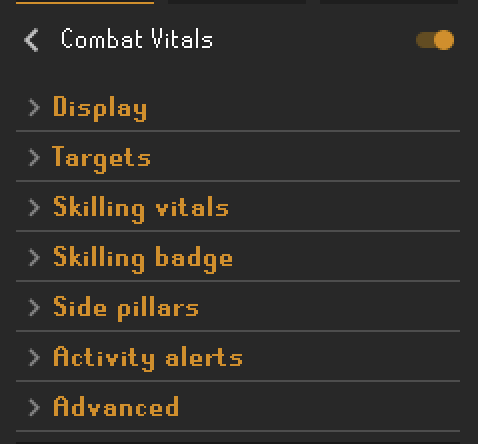

# Combat Vitals

Opponent health for NPC and player targets, drawn over the target instead of
only in a corner panel, and honest about what the number is worth.

A standalone replacement for RuneLite's built-in **Opponent Information**.

<p align="center">
  
</p>

<p align="center"><em>A player target at 33%. The number comes from the hiscores;
the bar is sized to the text so the two never collide.</em></p>

---

## Contents

- [Why this exists](#why-this-exists)
- [Features](#features)
- [About that number](#about-that-number)
- [Watching it work](#watching-it-work)
- [How it compares to Opponent Information](#how-it-compares-to-opponent-information)
- [Settings](#settings)
- [Compatibility](#compatibility)
- [Privacy and network use](#privacy-and-network-use)
- [How it works](#how-it-works)
- [Troubleshooting](#troubleshooting)
- [Building from source](#building-from-source)
- [Credit](#credit)
- [Licence](#licence)

---

## Why this exists

Opponent Information draws a panel in the top-left corner. You watch a fight in
the middle of the screen and read the health in the corner, and the number it
shows is a guess presented in the same typeface as a fact.

This plugin draws the readout **on the target**, and documents exactly how much
the number can be trusted, because the honest answer is "mostly, except at the
one moment you care most", and nobody says so.

## Features

**Overhead rendering.** The readout is drawn at the target in the game world.
Three styles:

| Style | Behaviour |
|---|---|
| **Bar behind text** | Draws a health bar sized to fit the text, with the text inside it. The bar carries the colour, the text stays white. |
| **Text above health bar** | Lifts the text clear of the game's own bar rather than covering it. |
| **Text only** | Draws where it falls. Will overlap the game's bar. Included for completeness. |

**Works on player targets**, not just NPCs. No other Plugin Hub plugin draws
overhead health for players.

**Both sides of the fight, in one visual language.** Your own health can be
drawn the same way as your opponent's. Other plugins can show your health, but
none of them will match this readout. You would get yours in one style and
theirs in another, side by side.

<p align="center">
  
</p>

<p align="center"><em>Yours on the left, theirs on the right, identical styling.
Your own number comes from the hitpoints orb, so it is exact, never recovered.</em></p>

**Stat comparison** against a player opponent, from the same cached hiscores
result the health lookup already fetched. No second request.

**Vertical placement** of Top, Middle or Bottom plus a pixel offset, because a
large NPC's name plate and the top-of-screen boss bar both crowd the space above
their head, and the right answer differs per monster.

**Configurable colour ramp.** Three stops (full, half, empty), each with an
alpha channel. Interpolated, so the colour slides rather than snapping between
bands.

**Display formats.** Hitpoints, percentage, or both, with optional decimal
precision on the percentage.

**Configurable opponent timeout.** How long the readout lingers after combat
ends. Opponent Information fixes this at five seconds; here it is 1–60.

**Gets out of the way.** Stands down when the game's own boss health bar is
showing the same target, and hides its panel while Opponent Information is
enabled so the two never stack in the same corner. Both are switchable.

**Skilling vitals.** Click a fishing spot, or any other skilling NPC that
cannot be fought, and the same badge appears over your own head, where your
health bar sits, with the skill's icon in place of a health number:
`Fishing 79 (+3) 45s`. Your boosted level, the boost, and the seconds until it
drops by one, with the bar draining alongside. It is drawn over you, never over
the spot: the spot moves, and the level is yours. If your health bar is up at
the same time (something hit you while you fished) the badge sits above it.
Wield a dragon, infernal, crystal or 3rd age axe, pickaxe or harpoon and the
badge adds your remaining special attack energy. When the boost came from
something the plugin saw happen, the potion you drank, the pie you ate, the
tool you spec'd, it says so; otherwise it says nothing rather than guess. When
the boost drops or wears off the badge flashes red for a moment, and can send a
RuneLite notification if you turn that on.

**What you can catch.** On a fishing spot the badge also shows the fish the
method you clicked can land at your current boosted level, as small icons
beside the level: Net on a shrimp spot at Fishing 10 shows shrimps only, since
anchovies need 15; Bait on the same spot shows sardine and herring. Up to three
icons, then `+N`. The fish you last caught, from the `You catch some shrimps.`
message or from it landing in your inventory, leads and the others fade. The
spot type comes from RuneLite's own fishing spot table and the levels from the
OSRS wiki; a spot the plugin does not know shows the skill and level alone.

**Inventory fill.** Under the badge sits a thin bar that runs from green
through yellow to red as your inventory fills. Only what you are gathering
counts: feathers, bait, coin pouches and anything else that stacks, your tools
(net, rod, pot, axe, pickaxe, hammer...) and anything you can wield or wear
hold their slot for the whole trip, so they shrink the capacity instead. A
harpoon and 27 fish is solid red. It uses the health colours from Display,
run backwards.

**Activity alerts.** RuneLite notifications for the moments you would
otherwise miss while looking at something else, each with its own toggle in
the *Activity alerts* section. They go through RuneLite's notifier, so your
RuneLite notification settings (tray, flash, sound, focus) decide how they
arrive; the plugin plays nothing of its own.

- *Inventory full* while fishing, woodcutting, mining, hunting or thieving.
- *Stopped gathering*: no gathering animation or experience for five seconds
  (configurable). It knows the difference between stopping and stopping on
  purpose: walking off (to the next spot, or the bank), opening the bank,
  dropping or depositing, logging out or hopping never fire it, and neither
  does a full inventory or a moved spot, which have their own alerts.
- *Fishing spot moved*, when the spot you are on disappears from under you.
- Thieving: *stopped thieving* (a stun is not stopping), *coin pouches at
  cap* (28 by default; raise it if the Ardougne Diary lifted yours),
  *pickpocket stun*, and *dodgy necklace broke*.
- *Make-X finished* for cooking, fletching, crafting and smithing, and *low
  run energy*, both off by default.

Woodcutting and mining alerts work from your experience drops, so they fire
even though the badge does not come up for trees and rocks yet.

The timer is honest about what it knows. The game never tells the client where
it is in its one-minute drain cycle, so from login the badge shows an estimate
marked `~`, and once it has seen a boost actually drop the mark goes away and
the number is exact. Preserve stretches the cycle to 90 seconds and is
accounted for, using the same model as RuneLite's own Boosts plugin.

## About that number

**Opponent health is never sent to your client.** The server broadcasts a health
*bar*: a ratio out of a fixed scale. Every plugin that shows a number, this one
and RuneLite's built-in included, is inverting that ratio to guess.

The scale is **30**. That was measured on a live world, not assumed.

### What that means

**NPCs at or below 30 max hitpoints are exact.** A Guard on 22 resolves to one
value, always. No guessing involved.

**Players never are.** Above 30 max hitpoints the ratio maps to a band of three
or four possible values, and the number shown is the middle of that band.

For an 88 hitpoint opponent showing ratio 10, the true health is 28, 29 or 30.
The readout says 29. That is the best single guess available, never wrong by
more than one, but it is still a guess, and RuneLite's built-in plugin renders it
identically to the maximum beside it, which it genuinely knows.

| Max hitpoints | Midpoint exactly right | Worst error |
|---:|---:|---:|
| 45 | 67% | 1 |
| 88 | 34% | 1 |
| 99 | 30% | 2 |

### The error that actually matters

Quantisation is the small problem. This is the large one:

> **After your opponent eats, the health bar you can see lags behind.**

Measured across 386 cross-checked readings from a real fight between two
accounts, each logging its own true hitpoints and the ratio it observed for the
other:

- Every reading that was wrong was wrong in the **same direction**, showing
  less health than the target actually had.
- Typical catch-up: **two game ticks**. Worst observed: **four ticks**.
- Worst single reading: **19 hitpoints stale.**

Nothing in the client API reports that an opponent ate. This cannot be detected,
flagged, or corrected. Not by this plugin, and not by RuneLite's built-in one,
which carries the identical error silently.

**The practical version:** trust the number while you are trading hits. Distrust
it for a second or two after they eat, which is exactly when you most want to
trust it. That is a property of the game's networking, not of any plugin.

Method, numbers and the cross-account analysis script are in
[BRIEF.md](BRIEF.md) under Phase 0.5 and [`docs/phase-0.5/`](docs/phase-0.5/).
The raw captures are deliberately not committed: they name real accounts.

### Watching it work

The same fight, as the target drops. The colour ramp is interpolated, so it
slides rather than snapping between bands:

| 67% | 33% | 23% |
|:---:|:---:|:---:|
|  |  |  |

Real PvP, not a test dummy: skulled, in the wilderness, hitsplats landing. The
readout stays legible over a moving target against cave-floor terrain, which is
the case that broke every earlier iteration of this overlay.

## How it compares to Opponent Information

| | Opponent Information | Combat Vitals |
|---|---|---|
| Corner panel | Yes | Yes |
| Drawn at the target | No | Yes |
| Overhead for players | No | Yes |
| Colour by health | No | Yes, three configurable stops |
| Opponent timeout | Fixed 5s | 1–60s |
| Player hiscores lookup | Always on, no switch | On by default, switchable |
| Documents its own accuracy | No | Yes |
| Combat stat comparison panel | Yes | Yes |
| Shows your own health too | No | Yes |

## Settings

### Display

| Setting | Default | What it does |
|---|---|---|
| Show panel | On | Corner panel, like the stock plugin |
| Show over target | On | Overhead readout in the game world |
| Display | Both | Hitpoints, percentage, or both |
| Decimal percentage | Off | One decimal place on percentages |
| Colour by health | On | Fade the readout as health drops |
| Colour at full / half / empty | Green / amber / red | The three gradient stops, with alpha |
| Overhead style | Bar behind text | See the table above |
| Bar background | Opaque black | Fill behind the health bar. Lower the alpha to let the game's bar show through |
| Overhead position | Top | Top, Middle or Bottom relative to the target |
| Overhead offset | 0 | Extra height in pixels, ±200 |
| Hide game health bar | Off | Hide the game's own health bar over everyone, yours included |
| Hide game chat under readout | Off | While the readout or skilling badge covers someone's overhead chat and the plugin redraws it above, hide the game's own line so only one shows. You and your opponent only; the badge is over your own head, so a skilling NPC is never touched |

### Targets

| Setting | Default | What it does |
|---|---|---|
| NPC targets | On | Show the readout when fighting NPCs |
| Player targets | On | Show the readout when fighting players |
| Draw over players | On | Off keeps players in the panel only |
| Look up player hitpoints | On | Hiscores lookup for the opponent's max hitpoints |
| Show your own health | On | Draw your health over your character while engaged. Exact, from the orb |
| Stat comparison panel | Off | Compare your combat stats to a player opponent's, in the panel |

<p align="center">
  
</p>

### Skilling vitals

| Setting | Default | What it does |
|---|---|---|
| Skilling badge | On | Draw the badge over your head while you work a fishing spot or other skilling NPC |
| Show what you can catch | On | On a fishing spot, icons of the fish the clicked method lands at your level, up to three then `+N` |
| Show boost timer | On | Seconds until the boost drops by one, `~` while estimated from login |
| Show boost source | On | Name the potion, food or special attack the boost came from, when seen |
| Show spec energy | On | Remaining special attack energy when wielding a spec skilling tool |
| Notify on boost drop | Off | RuneLite notification when the badge's boost drops or wears off |
| Show inventory fill | On | Thin bar under the badge, green to red as the inventory fills; stackables, tools and equipment do not count |

### Activity alerts

Every alert is a RuneLite notification with its own toggle, and follows your
RuneLite notification settings.

| Setting | Default | What it does |
|---|---|---|
| Inventory full | On | The last free slot fills while fishing, woodcutting, mining, hunting or thieving |
| Stopped gathering | On | No gathering animation or experience for the delay below. Not when you walk off, bank, drop or deposit, log out or hop |
| Stopped after (s) | 5 | How long counts as stopped, for gathering, thieving and make-X |
| Fishing spot moved | On | The spot you are working moves away |
| Stopped thieving | On | Pickpocketing or stalls stopped for the delay; a stun does not count |
| Pickpocket stun | **Off** | A failed pickpocket stuns you. Off because at most levels it fires every few attempts |
| Coin pouches at cap | On | The coin pouches you hold reach the cap below |
| Coin pouch cap | 28 | Pouches before the alert; raise it if the Ardougne Diary lifted your cap |
| Dodgy necklace broke | On | Your dodgy necklace uses its last charge. RuneLite's Item Charges plugin can send the same one: keep one of the two |
| Make-X finished | **Off** | Cooking, fletching, crafting or smithing stopped for the delay. Off because RuneLite's Idle Notifier already covers it for many players |
| Low run energy | **Off** | Run energy drops below the threshold below |
| Low run energy (%) | 10 | The threshold for that alert |

Known limits, until they are checked in game: eating or otherwise using up
items counts as stopping on purpose, so stopping right after eating does not
alert; when pickpocketing a wandering NPC, walking after it without a success
does the same.

<!-- Screenshots still to take in game, for docs/images/:
  1. inventory-fill-empty.png  : badge on a fishing spot, inventory empty, green bar.
  2. inventory-fill-half.png   : same, about 14 fish, yellow bar.
  3. inventory-fill-full.png   : harpoon plus 27 fish, red bar.
  4. inventory-fill-stack.png  : badge with your health bar up too, fill bar between them.
  5. alerts-settings.png       : the Activity alerts section of the config panel.
  6. alert-notification.png    : a "You have stopped fishing" tray notification.
-->

### Advanced

| Setting | Default | What it does |
|---|---|---|
| Opponent timeout | 5s | How long the readout stays after combat ends, and how long the skilling badge lingers after you stop |
| Hide behind boss HP bar | On | Stand down when the game's boss bar shows the same target |
| Hide panel if stock plugin is on | On | Avoid stacking two panels in one corner |

## Compatibility

**Opponent Information.** Safe to run both. This plugin hides its own panel
while the stock one is enabled, so you get the stock panel plus this plugin's
overhead rendering. Turn the stock plugin off to see this one's panel, or turn
off *Hide panel if stock plugin is on* to force both.

**Entity Hider.** If Entity Hider is hiding an actor's 2D layer, the game's
health bar is already gone and this plugin's overhead readout is unaffected,
since it draws independently.

**Boss health bar.** When the game shows its own top-of-screen bar for your
target, this plugin stands down by default rather than duplicating it.

## Privacy and network use

**One request type, to Jagex.** When you engage a player, their display name is
sent to Jagex's own hiscores service to look up their Hitpoints level, so their
health can be shown as a number rather than a percentage. One request per
opponent, cached for an hour, shared with RuneLite's own hiscore cache so
enabling several plugins cannot multiply requests.

The request is made only in direct response to you engaging that specific
target. Never speculatively, never for bystanders, never for more than one
player at a time.

Turn it off with **Targets → Look up player hitpoints**. Player targets then
show a percentage. RuneLite's built-in Opponent Information performs the same
lookup with no way to disable it.

**Nothing else leaves your machine.** No account identifiers, no telemetry, no
third-party servers, no data about other players sent anywhere.

## How it works

The server computes the health bar as:

```
healthRatio = 1 + (healthScale - 1) * health / maxHealth
```

with integer division, and forces `healthRatio = 0` when health is 0. Inverting
that gives a *range* of healths consistent with what you can see, which collapses
to a single value only when `maxHealth <= healthScale`.

Maximum health comes from the NPC cache for monsters, and from the hiscores for
players. Without it, only the fraction of the bar is knowable, which is why an
unranked player degrades to a percentage rather than a wrong number.

**Your own health skips all of this.** The client knows it exactly, from the
hitpoints orb, so it is never put through the recovery. Printing a guessed 29
where the truth is a known 30 would be absurd, and would undermine the only
claim this plugin makes. The readout is exact for you, exact for small NPCs, and
banded only where the data genuinely is.

The recovery is pure arithmetic with no client dependency, and is covered by
unit tests including exhaustive checks that the recovered range always contains
the true health, and that the midpoint is never off by more than half the range
width, across every `(maxHealth, health)` pair up to 120.

The readout is rebuilt once per game tick and published as an immutable
snapshot. Overlays render that snapshot and compute nothing themselves, because
they run every frame while the underlying bar changes only on a tick.

## Troubleshooting

**Nothing appears when I attack something.** The readout only tracks a target
*you* engaged. Being attacked does not show the attacker, by design; it does
show your own health, if that option is on, until the opponent timeout passes.

**No health bar appears when I click a fishing spot, a banker or a pet.**
Correct. Those are NPCs, but they cannot be fought, so they are never a combat
target. A fishing spot, or any NPC whose menu names a skill (Net, Harpoon,
Pickpocket, Catch…), gets the skilling badge instead. A banker or a pet gets
nothing.

**The skilling badge shows no timer.** Either *Show boost timer* is off, the
skill is not boosted, or the plugin was enabled mid-session and has not yet
seen a boost drop, which is the only way it can learn the drain cycle's phase
without a login. The timer appears at the first drop.

**The skilling badge shows no source for my boost.** The plugin only names a
source it saw: a Drink or Eat, or a special attack from a recognised tool,
within a couple of ticks of the boost rising. A boost from anything else, or
one applied before the plugin was enabled, shows no source rather than a guess.

**The badge shows no fish on a fishing spot.** Either *Show what you can catch*
is off, your level is below the first fish for that method, or the spot is one
the plugin has no table for (aerial fishing, quest spots, the Civitas illa
Fortis park, squid). It also needs to have seen you click the spot: the method
comes from the menu option you chose, so a spot engaged without a click shows
the level alone until you click again.

**The badge is over my head, not the spot.** By design. The spot moves every
minute or so, it is small, and the level on the badge is yours, not its.

**The panel never shows.** Opponent Information is probably enabled, and this
plugin hides its panel to avoid stacking. Disable the stock plugin, or turn off
*Advanced → Hide panel if stock plugin is on*.

**A player shows a percentage instead of a number.** Either the hiscores lookup
is off, the lookup has not returned yet (the first one is asynchronous and takes
a moment), or the player is unranked. All three degrade to a percentage rather
than showing something wrong.

**The text sits on top of the game's health bar.** Use *Bar behind text*, which
covers it, or *Text above health bar*, which clears it. Fine-tune with
*Overhead offset*.

**The text collides with a large NPC's name plate.** Set *Overhead position* to
Middle or Bottom for that fight.

**Nothing shows on a boss.** The game's own health bar is probably up, and this
plugin defers to it. Turn off *Hide behind boss HP bar* to override.

## Building from source

```bash
./gradlew build          # compile and run the tests
./gradlew run            # launch a developer client with the plugin loaded
```

Requires a JDK; the build targets Java 11 bytecode. To log in to the development
client, follow
[Using Jagex Accounts](https://github.com/runelite/runelite/wiki/Using-Jagex-Accounts).

There are no dependencies beyond RuneLite itself, deliberately.

## Credit

The ratio-to-health recovery is derived from `OpponentInfoOverlay` in the
RuneLite client, which is BSD-licensed. This plugin reimplements it with the
range kept explicit rather than collapsed to a midpoint internally, which is
what made the accuracy documented above measurable in the first place.

## Licence

BSD 2-Clause. See [LICENSE](LICENSE).
