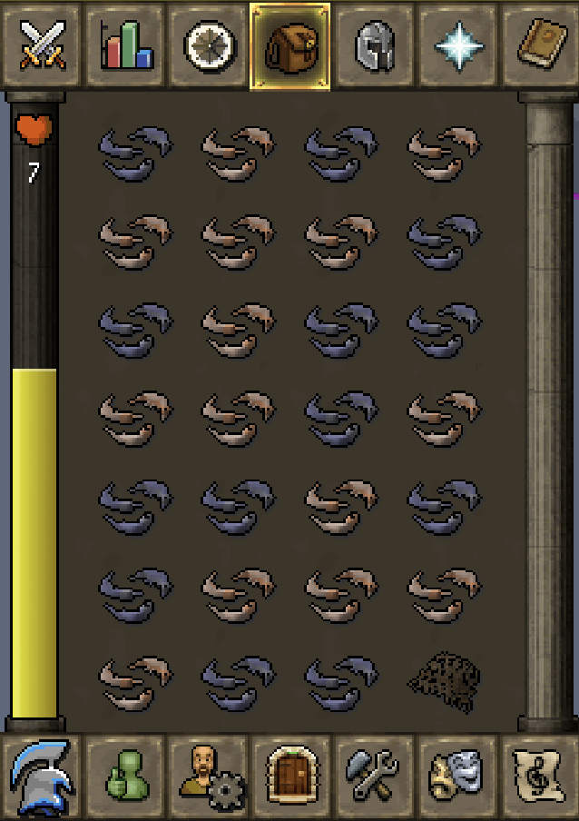
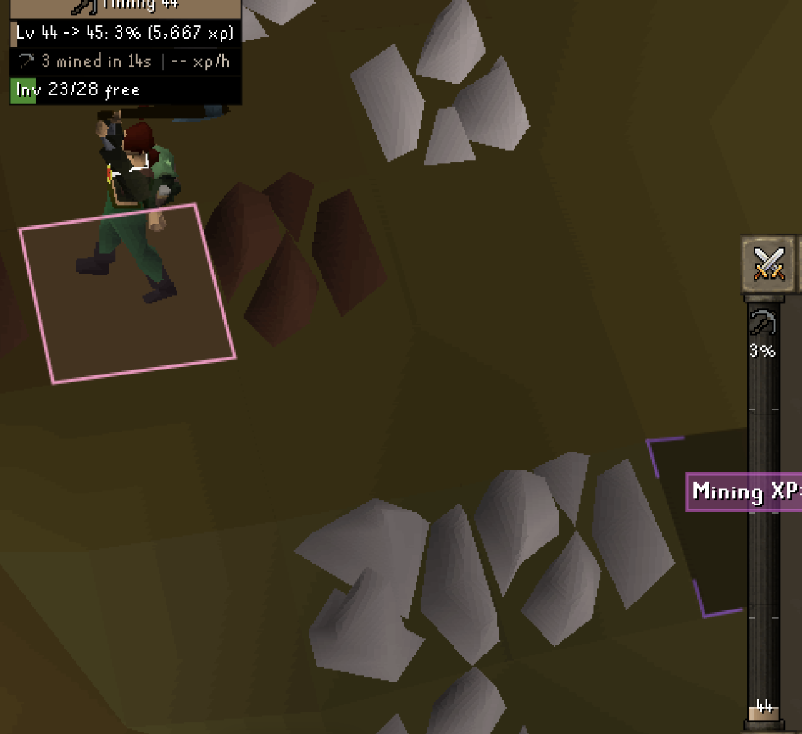
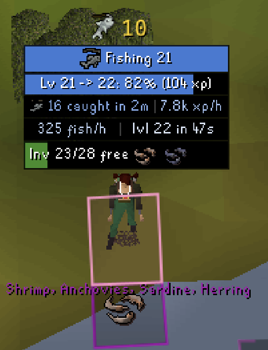

# Combat & Skilling Vitals

I had a pile of plugins installed to track opponent health, skilling progress,
containers, aggression timers, casts, and AFK alerts, so I combined the ones I
use every day into one plugin with a shared look, one sidebar panel, and one
alert and voice system.

**Combat vitals** and **Skilling vitals** have separate master switches at the
top of the settings, so you can run everything together or keep only the pieces
you want.

  

**Getting started**

1. Install **Combat & Skilling Vitals** (`combat-vitals`) from the Plugin Hub.
2. Open its sidebar panel (the health-and-skilling bar icon in RuneLite's sidebar).
3. Pick a preset on the **Presets** tab (*Skiller*, *PvM*, *Minimal*, or *Everything*), or jump straight into combat or skilling.

Full setup, every setting and default, troubleshooting, and build commands are in
[SETUP.md](SETUP.md).

---

## Covers these plugins

Everything below works in one matching style, and plays nicely if you keep any
of these enabled alongside it.

### Plugin Hub plugins

| Plugin | What Combat & Skilling Vitals covers |
|---|---|
| [NPC Health Text](https://runelite.net/plugin-hub/show/npc-health-text), [Monster HP Percentage](https://runelite.net/plugin-hub/show/monster-hp-percentage), [Custom HP Bar](https://runelite.net/plugin-hub/show/custom-hp-bar) | Overhead hitpoints, percentage, or both above active NPC targets, PvP player targets, and your own character, with separate boss/high-HP rules, 3-stop colour fade, *Only after damage*, and optional game health bar replacement. |
| [Gemstone Crab](https://runelite.net/plugin-hub/show/gemstone-crab-timer), [Gemstone Crab Alert](https://runelite.net/plugin-hub/show/gemstone-crab-alert) | Gemstone Crab health %, ~10-minute burrow countdown, 90-second shell timer, crawl-through cave outline and arrow, and spawn, pre-burrow, and tunnel-ready alerts. |
| [Remaining Casts](https://runelite.net/plugin-hub/show/remaining-casts), [Autocasting](https://runelite.net/plugin-hub/show/autocast-utilities) *(combat spells)* | Active spell, rune icons, and remaining casts from inventory, rune pouch, combo runes, staves, and charged fire/water tomes (*Always show*, *Show only below*, low-casts alert). Does not add spellbook hover tooltips or Lunar/Arceuus utility spells. |
| [Inventory Notifier](https://runelite.net/plugin-hub/show/inventory-notifier), [Fish Barrel](https://runelite.net/plugin-hub/show/fish-barrel), [Log Basket](https://runelite.net/plugin-hub/show/log-basket) | Full-inventory alerts while gathering or thieving, slot-aware green-to-red capacity bar, checked log basket item breakdown, fish barrel tracking, and two-colour open-container side pillar. |
| [CoalBag](https://github.com/WolffTech/coal-bag-plugin), [Essence Pouch Tracker](https://runelite.net/plugin-hub/show/essence-pouch-tracking), [GP Per Hour](https://runelite.net/plugin-hub/show/gp-per-hour) *(containers)* | Coal bag fill (`27`, or `36` with Smithing cape) and Small–Colossal essence pouch fill and degraded capacities on the badge and **Live** tab. Does not draw over inventory item icons or track GP profit. |
| [Forestry Tracker](https://runelite.net/plugin-hub/show/forestry-tracker), [Ent Trimmer](https://runelite.net/plugin-hub/show/ent-trimmer) | Forestry event spawn alerts, post-event XP and reward summaries in chat, Forestry kit leaf counts, and solved target outlines and labels across all 9 events (including Friendly Entling prune requests). |
| [Idle Alarm](https://runelite.net/plugin-hub/show/idle-alarm), [Instant Idle Notify](https://runelite.net/plugin-hub/show/instant-idle-notify), [AFK Countdown](https://runelite.net/plugin-hub/show/afk-countdown) | Repeating audio or spoken voice alarms on skilling/pumping stops (silenced on click, keypress, or XP), live remaining production inputs and ETA, and client idle-logout countdowns while pumping, splashing, or at the Gemstone Crab. |
| [Clue Scroll Notifier](https://runelite.net/plugin-hub/show/clue-scroll-notifier), [Sound Alerts Expanded](https://runelite.net/plugin-hub/show/sound-alerts-expanded) | Skilling clue drop alerts with tier, custom WAVs in `.runelite/plugin-data/combat-vitals/sounds/`, 3 synthesised sound packs, offline voice lines, and timed sidebar muting across 22 alerts. |
| [XP Goalz](https://runelite.net/plugin-hub/show/xp-goalz), [Goal Tracker](https://runelite.net/plugin-hub/show/goal-tracker), [Daily Goals](https://runelite.net/plugin-hub/show/daily-goals) | Per-account Skill level, Skill XP (to 200M), Boss kills, Item, Daily, and Weekly goals in the **Goals** tab and **Live** cards, with ETAs, actions left, UTC resets, and **Goal reached** alerts. |
| [Max Hit](https://runelite.net/plugin-hub/show/maxhitplugin), [Max Hit Calculator](https://runelite.net/plugin-hub/show/max-hit-calculator), [DPS Calculator](https://runelite.net/plugin-hub/show/dps-calculator) | **Max Hit** sidebar tab calculating melee, ranged, and magic max hit, hit chance, average damage, and DPS from worn gear, boosted stats, prayers, stance, Void, and bundled NPC Magic defence, with editable what-if inputs. |

### Built-in RuneLite plugins

| Built-in plugin | How Combat & Skilling Vitals covers or works with it |
|---|---|
| **Opponent Information** | Corner target-health panel, overhead NPC and PvP player health, single-opponent Hitpoints lookup (with an opt-out toggle), and PvP **Stat comparison panel**; auto-hides its own corner panel while Opponent Information is on. |
| **NPC Aggression Timer** | 10-minute unprovoked-aggression countdown panel and optional 21x21 ground boundary lines; independent of the built-in plugin's custom area calibration. |
| **Status Bars & XP Globes** | Vertical side pillars beside the inventory for target health, per-skill XP progress, and inventory/open-container fill; stacks to the left of Status Bars so bars never overlap. |
| **Boosts Information** | Preserve-aware stat-boost drain timer, boost source name, and optional boost-drop alert on the skilling badge. |
| **Idle Notifier, Item Charges & Random Events** | Stopped-gathering, spot-moved, stopped-thieving, Make-X, low-run-energy, dodgy necklace break, random-event, and pumping/splashing logout alerts that stay quiet when you walk off, bank, or drop items. |
| **Fishing, Woodcutting, Mining, Agility, Runecraft & XP Tracker** | Unified 17-skill badge and **Live** sidebar tab with session and login totals, idle auto-pause, catchable fish icons, Forestry target solvers, agility laps/marks, and degraded essence pouches. |

---

## Combat

- **Target and own health readout:** overhead health and optional corner box
  (*Show panel*) for engaged NPCs and PvP players, plus your own exact Hitpoints
  from the orb (*Show your own health*, also shown while pickpocketing). Supports
  *Bar behind text*, *Text above health bar*, or *Text only*, 3-stop health
  fade, *Only after damage*, separate *Big targets* rules for bosses/high-HP
  NPCs, single-opponent PvP hiscores lookup with *Stat comparison panel*,
  *Hide game health bar* ([docs/native-hp-bar.md](docs/native-hp-bar.md)), and
  *Chat above readout* ([docs/overhead-chat.md](docs/overhead-chat.md)).
  Opponent HP accuracy and eat-lag measurements: [docs/accuracy.md](docs/accuracy.md).
- **NPC aggression timer:** 10-minute countdown (`Aggressive for 9:54` to `NPCs
  are no longer aggressive here`) when an unprovoked NPC attacks you, resetting
  when you leave the 21x21 tolerance area, hop, change floors, or log out, with
  optional *Aggression area lines*.
- **One combined combat card (Casts left, Splashing & Gemstone Crab):** one
  compact card (`SplashOverlay`) that never splits into multiple boxes:
  - **Show casts left** (on by default): spell name, rune icons with per-cast
    cost, and casts remaining from inventory, rune pouch, combo runes, staves,
    and charged fire/water tomes, with *Always show*, *Show only below*, and
    *Casts: running low* alert.
  - **Splashing mode** ([docs/splashing.md](docs/splashing.md)): auto-detected at
    `<= -40` Magic attack bonus (*Auto-detect splashing*, on by default) or
    toggled manually on the card, **Live** tab, or **Targets** tab. Shows Magic
    attack bonus and OSRS Wiki hit chance (`0%` green at `-64`), client logout
    bar, `Casting m:ss` clock, 20-minute AFK combat-stop warnings (*Splash:
    stops soon*, *Splash: stopped*), *Splash: setup broke* alert, and dimmed
    post-cast linger (*Card stays (s)*).
  - **Gemstone Crab mode** (on by default): crab `Health %`, ~10-minute
    `Burrows in` timer, 90-second `Shell gone in` clock, nearest crawl-through
    cave outline and arrow (*Crab: cave arrow*) once burrowed, and spawn,
    about-to-burrow, and cave-ready alerts.
- **Side pillars:** optional vertical bars beside the inventory (*Status Bars*
  frame or *Flat*) showing target health in combat, or XP progress and
  inventory/open-container capacity while skilling, stacking cleanly to the left
  of RuneLite's Status Bars.

  

| Skilling pillars | Combat pillar | XP pillar |
|:---:|:---:|:---:|
|  |  |  |

---

## Skilling

- **17-skill badge:** draws *Over your head*, *Over the spot*, or *Fixed on
  screen* (Alt-drag) across Fishing, Woodcutting, Mining, Thieving, Runecraft,
  Hunter, Herblore, Cooking, Fletching, Crafting, Smithing, Firemaking, Prayer,
  Magic (skilling spells only), Agility (laps, lap time, marks of grace),
  Construction, and Sailing. Shows boosted level, Preserve-aware boost drain
  timer and source, skilling tool spec energy, XP progress, session count, XP/h
  and actions/h (auto-pausing after *Idle pause (s)*), time to level, remaining
  production materials (`14 left, done in ~25s`), and `Not <activity>` /
  `in combat` states.
- **Fishing & Hunter checks:** shows catchable fish icons for the clicked spot
  method (dimming or hiding higher-level fish), flashes missing fishing tools,
  bait, impling net/jar, or level on click (*Warn if missing gear*), and marks
  the nearest active fishing spot with a ground line, off-screen arrow, and
  optional **Shortest Path** route (*Next spot path*).
- **Inventory fill & containers:** slot-aware green-to-red inventory bar plus
  dedicated rows for **log/forestry baskets** (with per-log breakdown once
  checked and forestry kit leaves), **fish/fish sack barrels**, **coal bags**,
  and **essence pouches** (`?/28` until checked, never guessed), with optional
  *Count containers as free*.
- **Forestry solver & session auto-reset:** tracks Forestry XP and chat reward
  summaries, outlines the solved target in gold with an action label across all
  9 Forestry events (*Step here* on the unpaired ritual circle, *Pair* on
  pollinating bushes, *1st*/*2nd*/*3rd* sapling ingredients, *Anima root*,
  *Empty nest* / *Eggs here*, *Disarm* traps, *Stand under* rainbow, *Add logs*
  beeboxes, and Friendly Entling prune cuts; *All Forestry parts* outlines the
  rest too), and optionally resets the session when switching activities
  (*Auto-reset on new activity*).
- **Blast Furnace pump:** Strength XP badge with `AFK logout in` and 100-minute
  `Pump stops in` timers, plus world (`302, 303`), `Stove: no one stoking`, and
  calibrated `Coke runs out in` checks.

| Thieving | Mining | Fishing catch list |
|:---:|:---:|:---:|
|  |  |  |

| Pumping | Stove / world warning | Inventory full |
|:---:|:---:|:---:|
|  |  |  |

---

## Alerts, voice lines, and muting

- **22 activity & event alerts** (*Alerts and sounds*): Inventory full, Stopped
  gathering, Fishing spot moved, Stopped thieving, Pickpocket stun, Coin pouches
  at cap, Dodgy necklace broke, Make-X finished, Low run energy, Stopped
  pumping, Idle logout soon, Pump stops soon, Bird nest, Clue drop, Forestry
  event, Pet, Level up, Random event, Stove: coke runs low, Stove: no one
  stoking, Wrong world, and Mining and fishing events, plus combat/goal alerts
  (*Goal reached*, *Splash: setup broke*, *Splash: stops soon*, *Splash:
  stopped*, *Casts: running low*, and *Crab* alerts).
- **Sounds, voice lines & repeat:** share one profile with *Same for every
  alert* or set each alert to *RuneLite*, *Soft chime*, *Music box*, *Retro
  blip*, offline **Voice line** (*"You've stopped chopping yew logs."*), or **My
  sounds** (`.runelite/plugin-data/combat-vitals/sounds/<alert>.wav`), with
  optional repeat until you click, press a key, or gain XP again.
- **Muting:** silence everything from the sidebar's **Mute alerts** bar (**15
  min**, **30 min**, **60 min**), mute audio only with *Mute alert sounds*, or
  scale plugin sounds with *Follow game volume* (off by default).

---

## Sidebar panel

The sidebar button opens a six-tab panel with **Hide guides** and the **Mute
alerts** bar pinned at the top of every tab:

- **Live:** foldable live cards switched between **Combat** (quick *Splashing
  mode* toggle, HP/Prayer bars, Run on/off and Spec chips, target health, combat
  XP rate, session vs login total, combat goals), **Skilling** (active badge
  readout, 2x2 rate grid, method timer chips, containers, session vs total,
  skill goals), and **Overall** (*This session* top 3 / *Show all* and *Total
  since login*).
- **Goals:** per-account **Skill level**, **Skill XP**, **Item**, **Boss kills**
  (from game kill-count chat lines), **Daily** (00:00 UTC), and **Weekly**
  (Wednesday 00:00 UTC) goals with progress bars, session and last-hour ETAs,
  and actions left.
- **Max Hit:** live **Melee**, **Ranged**, and **Magic** max hit, hit chance,
  average hit, and DPS against NPCs, auto-filled from your worn gear, boosted
  levels, and bundled NPC Magic defence, with editable what-if spinners.
- **Overlays:** per-overlay switches plus **Show every overlay** and **Hide
  every overlay**, synced two-way with RuneLite's config list.
- **Presets:** *Skiller*, *PvM*, *Minimal*, and *Everything* with a `before ->
  after` preview before **Apply**, plus **Undo**.
- **Settings:** five guided tabs (**Combat**, **Targets**, **Skilling**,
  **Alerts**, **Look**) mirroring RuneLite's config sections in the same order
  (timeouts and chat update notes sit under *Advanced* in RuneLite's list).

### Combat tab

1. Leave Combat vitals ticked.
2. Tick Show over target for the readout over the monster, Show panel for the box.
3. Pick Display: hitpoints, percentage, or both.
4. Tick Hide game health bar to see only this plugin's bar.

### Targets tab

1. Tick NPC targets for monsters; Player targets for PvP.
2. Set Big target is to Bosses only, then Big targets to Both for hitpoints and percent on bosses.

### Skilling tab

1. Leave Skilling vitals and Skilling badge ticked.
2. Untick any skill you do not want a badge for.
3. Under Rows, untick rows you do not read; Badge layout on the Look tab makes it smaller.
4. Once you stop: choose how long the badge stays after you stop.

### Alerts tab

1. Tick Same for every alert.
2. Pick Voice line as the sound and set the volume, e.g. 40.
3. Tick Repeat every alert if you want it again until you are back.
4. Open Inventory full and click Test to hear it.

### Look tab

1. Pick a Style for the readout over your target.
2. Change the three health colours; the preview bar shows the fade.
3. Move the badge with Badge position and Badge offset; the preview shows where.
4. Side pillars: pick Combat, Skilling or Both.

---

## Privacy

When you attack a player, their display name is sent to Jagex's official
hiscores to look up their Hitpoints level, at most once per opponent and cached
for an hour. Turn it off with *Combat targets → Look up player hitpoints*.
Nothing else leaves your machine.

---

## Credits and licences

Licensed under the **BSD 2-Clause License** ([LICENSE](LICENSE); full
third-party notices in [NOTICE](NOTICE)).

- **Code and tables adapted from (BSD 2-Clause):**
  - **[RuneLite](https://github.com/runelite/runelite)** (BSD 2-Clause):
    health-bar ratio inversion, single-opponent tracking, player Hitpoints
    lookup, and boss HUD check (`OpponentInfoPlugin` / `OpponentInfoOverlay`);
    Preserve drain math (`BoostsPlugin#getChangeDownTicks`); degraded essence
    pouch table (`EssencePouchOverlay`); side-pillar geometry (`StatusBarsOverlay`
    / `BarRenderer`); decibel gain (`Notifier`); Forestry spawn IDs and ritual
    circle / flowering bush / sapling solvers, pet chat lines, and random-event
    NPC IDs (`WoodcuttingPlugin`, `ScreenshotPlugin`, `RandomEventPlugin`).
  - **[GP Per Hour](https://github.com/MosheBenZacharia/GP-Per-Hour)** by Moshe
    Ben-Zacharia (BSD 2-Clause): container check/empty chat wording and
    Fill/Empty inventory-delta tracking (`ContainerContents`).
- **Bundled audio and game data:**
  - **Sound packs** (*Soft chime*, *Music box*, *Retro blip*): synthesised
    in-repo by `tools/sounds/generate_packs.py` (BSD 2-Clause).
  - **Voice clips** (`voice/*.wav`): rendered offline with
    **[Kokoro-82M](https://huggingface.co/hexgrad/Kokoro-82M)** by hexgrad
    (Apache-2.0) and
    **[kokoro-onnx](https://github.com/thewh1teagle/kokoro-onnx)** by
    thewh1teagle (MIT).
  - **Game tables and formulas** (`fishing_spots.tsv`, `monster_magic.tsv`, boss
    IDs, fishing/impling levels, Blast Furnace stove stages, Forestry rules,
    spell rune costs, and splashing / max-hit formulas): from the
    **[Old School RuneScape Wiki](https://oldschool.runescape.wiki)**
    (CC BY-NC-SA 3.0), plus autocast varbit numbers from
    `jcarbelbide/autocasting`.
- **Inspired by (independent re-implementations, no code copied):**
  [NPC Health Text](https://runelite.net/plugin-hub/show/npc-health-text),
  [Monster HP Percentage](https://runelite.net/plugin-hub/show/monster-hp-percentage),
  [Custom HP Bar](https://runelite.net/plugin-hub/show/custom-hp-bar),
  [Gemstone Crab](https://runelite.net/plugin-hub/show/gemstone-crab-timer),
  [Gemstone Crab Alert](https://runelite.net/plugin-hub/show/gemstone-crab-alert),
  [Remaining Casts](https://runelite.net/plugin-hub/show/remaining-casts),
  [Inventory Notifier](https://runelite.net/plugin-hub/show/inventory-notifier),
  [Fish Barrel](https://runelite.net/plugin-hub/show/fish-barrel),
  [Log Basket](https://runelite.net/plugin-hub/show/log-basket),
  [Ent Trimmer](https://runelite.net/plugin-hub/show/ent-trimmer),
  [Idle Alarm](https://runelite.net/plugin-hub/show/idle-alarm),
  [Clue Scroll Notifier](https://runelite.net/plugin-hub/show/clue-scroll-notifier),
  [Sound Alerts Expanded](https://runelite.net/plugin-hub/show/sound-alerts-expanded),
  [XP Goalz](https://runelite.net/plugin-hub/show/xp-goalz),
  [Goal Tracker](https://runelite.net/plugin-hub/show/goal-tracker),
  [Max Hit](https://runelite.net/plugin-hub/show/maxhitplugin),
  RuneLite's **NPC Aggression Timer**, and `PluginMessage` routing to
  [Shortest Path](https://runelite.net/plugin-hub/show/shortest-path)
  (`Skretzo`, BSD 2-Clause).
