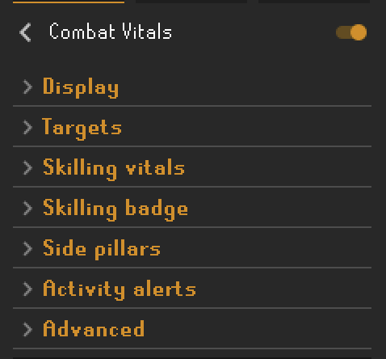
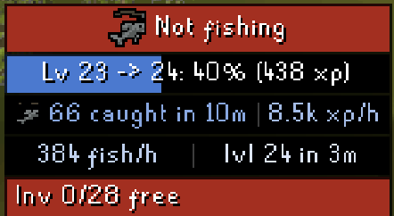
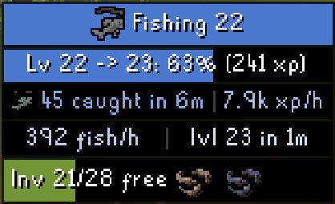

# Setup, settings and troubleshooting

Back to the [README](README.md).

- [Install](#install)
- [Settings](#settings)
- [Compatibility](#compatibility)
- [Troubleshooting](#troubleshooting)
- [Building and testing](#building-and-testing)
- [README screenshots](#readme-screenshots)

## Install

1. In RuneLite, open the Plugin Hub (the plug icon at the bottom of the
   configuration sidebar) and search for **Combat Vitals**.
2. Install it. It is on as soon as it installs.
3. Open its settings from the configuration sidebar. The defaults show your
   opponent's health over them, and the skilling badge while you gather.

## Settings

<p align="center">
  
</p>

RuneLite's list now has six sections, all collapsed, each the twin of a
sidebar panel tab with the same settings in the same order: **Combat
readout** (Combat tab), **Combat targets** (Targets), **Skilling badge**
(Skilling, which now also holds what was "Skilling: badge details" and the
next fishing spot), **Alerts and sounds** (Alerts: each alert's switch, then
"Same for every alert", the repeat timing, then each alert's own sound),
**Look** (colours, styles, positions and sizes, and the side pillars), and
**Advanced**. The tables below keep their old headings; every setting and its
key is unchanged.

### Master switches

At the top of the settings, above every section.

| Setting | Default | What it does |
|---|---|---|
| Combat vitals | On | Off: no corner panel, no readout over the target or over you, no game health bar swap, no combat side pillar |
| Skilling vitals | On | Off: no skilling badge, no skilling side pillars, no next fishing spot mark or path, no activity alerts or boost notifications; an alert already repeating stops |

Both halves on and Side pillars set to Both: the combat pillar shows while you
fight and the skilling pillars otherwise, as before. With one half off, its
pillars never show and the other half's take the bars.

### Display

| Setting | Default | What it does |
|---|---|---|
| Show panel | On | Corner panel, like the stock plugin |
| Show over target | On | Overhead readout in the game world |
| Display | Both | Hitpoints, percentage, or both |
| Decimal percentage | Off | One decimal place on percentages |
| Colour by health | On | Fade the readout as health drops |
| Colour at full / half / empty | Green / amber / red | The three gradient stops, with alpha |
| Overhead style | Bar behind text | Bar behind text; Text above health bar (clears the game's bar); Text only |
| Bar background | Opaque black | Fill behind the health bar. Lower the alpha to let the game's bar show through |
| Overhead position | Top | Top, Middle or Bottom relative to the target |
| Overhead offset | 0 | Extra height in pixels, ±200 |
| Hide game health bar | Off | Replace the game's own health bar: your target and you get the readout, and every other player and NPC that shows a bar gets a plain one in the game's place, so no bar goes missing |
| Chat above readout | On | While the readout or skilling badge is over you or your opponent, draw the game's overhead chat line above it instead of under it. Off: the game draws its own line. A skilling NPC is never touched |

### Targets

| Setting | Default | What it does |
|---|---|---|
| NPC targets | On | Show the readout when fighting NPCs |
| Player targets | On | Show the readout when fighting players |
| Draw over players | On | Off keeps players in the panel only |
| Look up player hitpoints | On | Hiscores lookup for the opponent's max hitpoints |
| Show your own health | On | Draw your health over your character while engaged. Exact, from the orb |
| Stat comparison panel | Off | Compare your combat stats to a player opponent's, in the panel |
| Big targets | Same as Display | Display for bosses and high-HP NPCs, e.g. Percentage |
| Other targets | Same as Display | Display for every other NPC, e.g. Hitpoints. Players always use Display |
| Big target is | Bosses + max HP | Bosses only, Bosses + max HP, or Max HP only. A boss is an NPC the game's boss health bar is showing, or one on a bundled list from the OSRS wiki's Boss page. Unknown max HP counts as an other target |
| Big target max HP | 200 | Max HP at or above which an NPC is a big target, 1–10000 |

### Skilling vitals

| Setting | Default | What it does |
|---|---|---|
| Skilling badge | On | Draw the badge over your head while you work a fishing spot, tree, rock, stall or other skilling NPC or object |
| Show what you can catch | On | On a fishing spot, icons of every fish the clicked method can give in the inventory line; ones above your level dimmed with the level they need |
| Show boost timer | On | Seconds until the boost drops by one, `~` while estimated from login |
| Show boost source | On | Name the potion, food or special attack the boost came from, when seen |
| Show spec energy | On | Remaining special attack energy when wielding a spec skilling tool |
| Notify on boost drop | Off | RuneLite notification when the badge's boost drops or wears off |
| Show inventory fill | On | `Inv 26/28 free` on a bar under the badge, green to red as the inventory fills; stackables, tools and equipment do not count toward the fill |
| Show containers | On | A line per carried log basket, fish barrel, coal bag or essence pouches under the inventory line, for the skill they serve: `Log basket 12/28 free`, or `?/28` until checked |
| Count containers as free | Off | `Inv 27/28 free (+16 basket)`, and Inventory full waits for the container to fill too; the coal bag and unchecked containers never count |
| Next spot arrow | On | Point the game's hint arrow at the nearest fishing spot, tree or rock of the kind you were working, when yours moves or runs out, or from the badge's right-click `Point to next spot`. Never replaces a quest or clue arrow |
| Arrow distance | 15 | Tiles you can walk from the next spot, once you have been near it, before the arrow comes down |

The timer is honest about what it knows. The game never tells the client where
it is in its one-minute drain cycle, so from login the badge shows an estimate
marked `~`, and once it has seen a boost actually drop the mark goes away.
Preserve stretches the cycle to 90 seconds and is accounted for.

### Skilling badge

| Setting | Default | What it does |
|---|---|---|
| Once idle | Show for a while | Off: the badge goes. Show for a while: it stays for the seconds below with a red `Not fishing` header. Until next activity: it stays until you start something else or a fight starts |
| Idle badge for (s) | 60 | How long `Not fishing` stays up |
| Idle header colour | Red | The header's colour while idle |
| Fishing, Woodcutting, Mining, Thieving, Runecraft, Hunter | On | Which skills get a badge |
| Header row, XP row | On | Turn rows off; the inventory row and catch list are in Skilling vitals |
| XP shown as | Both | `64%`, `1,234 xp`, or both |
| Inventory count | Free slots | `Inv 26/28 free` or `Inv 2/28 used` |
| Session count | Off | What you caught, chopped or mined this session and for how long, `24 caught in 3m`. Resets on logout |
| XP and actions per hour | Off | Hourly rates for the skill this session, `10.6k xp/h`, `459 fish/h`, after a minute |
| Reset session | Off | Tick to zero the session count and rates; unticks itself |
| Badge position | Over your head | Over your head; over the spot, tree or rock; or fixed on screen, Alt-drag to move |
| Badge offset | 0 | Pixels to raise the badge, ±200 |
| Badge size (%) | 100 | Scale the whole badge, 50 to 200 |
| Fish above your level | Dim | Dim them with the level, or hide them |
| Hide during combat | Off | Hide the badge while you are hit or hitting back |
| Fishing colour … Hunter colour | The palette | Per-skill colour overrides |
| Warn if missing gear | On | Click a fishing option without its tool, bait or level and the badge says `Needs: Fishing rod + bait` in red for 8 seconds. The click itself is never changed |
| Time to level | On | With XP and actions per hour on, how long the next level takes at this session's rate, `lvl 18 in 6m` |
| Badge layout | Full | Full: each session stat in its own column. Compact: one short line, `24 caught \| 10.6k xp/h` |

| Idle (`Not fishing`) | Session row | Compact layout |
|:---:|:---:|:---:|
|  |  |  |

### Side pillars

| Setting | Default | What it does |
|---|---|---|
| Show on side pillars | Off | Vertical bars beside the side panel, where RuneLite's Status Bars draws: Combat, your target's health; Skilling, XP to the next level and inventory fill; or Both |
| Target health on | Left | The pillar for your target's health |
| Skilling XP on | Left | The pillar for XP; inventory fill takes the other |
| Pillar labels | Icon and number | An icon for what it is with the number under it, the icon alone, or nothing |
| Pillar style | Status Bars | Status Bars: a dark frame with a shine and tick marks. Flat: one colour on the bar background |

Hover a pillar for the whole story: `Fishing XP: 82% to level 17 (65 xp left)`,
`Inventory: 10 of 28 free`, `Target: Rock Crab 12/50`. With Status Bars on,
these never overlap it: if it draws either bar, ours stack to the left of it.

### Activity alerts

Every alert is a RuneLite notification with its own toggle, and follows your
RuneLite notification settings.

| Setting | Default | What it does |
|---|---|---|
| Inventory full | On | The last free slot fills while fishing, woodcutting, mining, hunting or thieving |
| Stopped gathering | On | No gathering animation or experience for the delay below. Not when you walk off, bank, drop or deposit, log out or hop |
| Stopped after (s) | 5 | How long counts as stopped, for gathering, thieving and make-X |
| Fishing spot moved | On | The spot you are working moves away |
| Stopped thieving | On | Pickpocketing or stalls stopped for the delay; a stun does not count |
| Pickpocket stun | **Off** | A failed pickpocket stuns you |
| Coin pouches at cap | On | The coin pouches you hold reach the cap below |
| Coin pouch cap | 28 | Pouches before the alert; raise it if the Ardougne Diary lifted your cap |
| Dodgy necklace broke | On | Your dodgy necklace uses its last charge |
| Make-X finished | **Off** | Cooking, fletching, crafting or smithing stopped for the delay |
| Low run energy | **Off** | Run energy drops below the threshold below |
| Low run energy (%) | 10 | The threshold for that alert |

Known limits: eating counts as stopping on purpose, so stopping right after
eating does not alert; when pickpocketing a wandering NPC, walking after it
without a success does the same.

### Alert sounds

Closed by default. Every activity alert has its own settings here:

| Setting | Default | What it does |
|---|---|---|
| *Alert* sound | RuneLite | RuneLite, Soft chime, Music box, Retro blip, Voice line, or My sounds |
| *Alert* volume | 40 | Volume of the plugin's own sounds; RuneLite's sound keeps RuneLite's volume |
| Repeat *alert* | Off | Play the alert again, softly, until you are back |
| Repeat every (s) | 15 | Seconds between repeats |
| Repeat for (min) | 10 | Stop repeating after this long even if you are not back |

"Back" is any mouse press or key press in the client, starting the activity
again, logging out or hopping. The plugin only listens for those; it never
presses, clicks or types anything.

**My sounds** plays your own WAV from `.runelite/plugin-data/combat-vitals/sounds/`
(1.2.0 moved it there from `.runelite/combat-vitals/sounds/`; RuneLite moves an
existing folder for you), one
file per alert: `inventory-full.wav`, `gathering-stopped.wav`, `spot-moved.wav`,
`thieving-stopped.wav`, `stunned.wav`, `coin-pouch-cap.wav`,
`necklace-broke.wav`, `production-finished.wav`, `low-run-energy.wav`. If the
file is not there, RuneLite's sound plays and the chat says so once.

### Advanced

| Setting | Default | What it does |
|---|---|---|
| Timeout (s) | 5s | How long the readout stays after combat ends, and how long the skilling badge lingers after you stop |
| Hide behind boss HP bar | On | Stand down when the game's boss bar shows the same target |
| Hide if Opponent Info on | On | Avoid stacking two panels in one corner |

## Compatibility

**Opponent Information.** Safe to run both. This plugin hides its own panel
while the stock one is enabled. Turn the stock plugin off to see this one's
panel, or turn off *Hide if Opponent Info on* to force both.

**Entity Hider.** If Entity Hider is hiding an actor's 2D layer, this plugin's
overhead readout is unaffected, since it draws independently.

**Boss health bar.** When the game shows its own top-of-screen bar for your
target, this plugin stands down by default.

## Troubleshooting

**Nothing appears when I attack something.** The readout only tracks a target
*you* engaged. Being attacked does not show the attacker, by design; it does
show your own health, if that option is on.

**No health bar on a fishing spot, a banker or a pet.** Those cannot be fought.
A fishing spot, or any NPC whose menu names a skill (Net, Pickpocket…), gets the
skilling badge instead. An NPC you can both fight and skill, like a Man, is
decided by the option you clicked.

**The badge for a tree or rock.** The plugin goes by the option you clicked
(Chop down, Mine, Steal-from, Craft-rune) and waits until you are animating
beside it. It goes at once when you walk away or click something else.

**No timer on the badge.** *Show boost timer* is off, the skill is not boosted,
or the plugin was enabled mid-session and has not yet seen a boost drop.

**No source for my boost.** The plugin only names a source it saw: a Drink or
Eat, or a special attack, within a couple of ticks of the boost rising.

**No fish on a fishing spot.** *Show what you can catch* is off, your level is
below the first fish for that method, or the spot is one the plugin has no table
for (aerial fishing, quest spots, squid). It also needs to have seen you click
the spot.

**The panel never shows.** Opponent Information is probably enabled. Disable it,
or turn off *Advanced → Hide if Opponent Info on*.

**A player shows a percentage instead of a number.** The hiscores lookup is off,
has not returned yet, or the player is unranked.

**The text sits on the game's health bar.** Use *Bar behind text* or *Text above
health bar*, and fine-tune with *Overhead offset*.

**Nothing shows on a boss.** The game's own health bar is up and this plugin
defers to it. Turn off *Hide behind boss HP bar*.

## Building and testing

```bash
./gradlew build          # compile and run the tests (headless, no display needed)
./gradlew run            # launch a developer client with the plugin loaded
```

Requires a JDK; the build targets Java 11 bytecode. To log in to the development
client, follow
[Using Jagex Accounts](https://github.com/runelite/runelite/wiki/Using-Jagex-Accounts).

Development builds use the newest RuneLite release (`latest.release`); `run` and
`test` print the version they resolved. Pin one with
`./gradlew build -PruneLiteVersion=1.13.6`. The Plugin Hub replaces
`build.gradle` when it builds the plugin, so none of this affects the published
version.

`DocsLinksTest` fails the build if any image or local link in the README, this
file or `docs/` does not resolve, or a README image is over its size budget.

## README screenshots

Two kinds, never showing an account name or another player's name:

- **Drawn by the plugin's own painters** (badge and side pillars), headless, on a
  neutral backdrop: `./gradlew readmeShots` writes them to
  `docs/images/generated/`. `ReadmeShotsTest` holds the scenes; a plain
  `./gradlew test` draws them to `build/readme-shots/` and only checks them.
- **Taken in game**, for what needs the real game in motion. The shot list, with
  the exact settings per shot, is [docs/shot-list.md](docs/shot-list.md).
