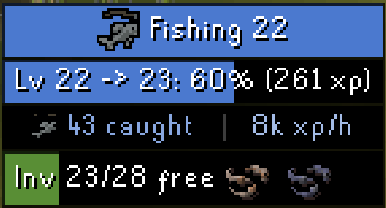

# Setup, settings and troubleshooting

Back to the [README](README.md).

- [Install](#install)
- [Which version has what](#which-version-has-what)
- [Sidebar panel](#sidebar-panel)
- [Settings](#settings)
- [Compatibility](#compatibility)
- [Privacy](#privacy)
- [Troubleshooting](#troubleshooting)
- [Building and testing](#building-and-testing)
- [README screenshots](#readme-screenshots)

What each feature does is in [docs/features.md](docs/features.md).

## Install

1. In RuneLite, open the Plugin Hub (the plug icon at the bottom of the
   configuration sidebar) and search for **Combat Vitals** (slug
   `combat-vitals`). The Hub lists version 1.1.0 under that name; the rename to
   **Combat & Skilling Vitals** arrives with 1.2.0.
2. Click **Install**. The plugin turns on right away, showing target and own
   health in combat and the skilling badge while you fish, chop, mine, steal,
   runecraft or hunt.
3. Open **Combat Vitals** in RuneLite's configuration list for the settings.

Version 1.2.0 is an open Plugin Hub pull request. When it merges, the plugin
also gets its own sidebar button (the health-bar-over-skilling-bar icon in
RuneLite's toolbar), and every setting is synced two-way between the panel and
the configuration list.

## Which version has what

This file describes `main`. The Plugin Hub has **1.1.0** today, so parts of what
follows are not installable yet. Sections and settings carry a mark:

- **Coming in 1.2.0:** in the open 1.2.0 Plugin Hub update.
- **After 1.2.0:** on `main` only (1.3.0 and newer), not submitted yet.
- No mark: in 1.1.0.

Settings that are **not in 1.1.0**, by the group they sit in:

| Version | Settings |
|---|---|
| **Coming in 1.2.0** | Master switches (*Combat vitals*, *Skilling vitals*); the skill switches Herblore, Cooking, Fletching, Crafting, Smithing, Firemaking, Prayer, Magic, Agility, Construction and Sailing; *Show containers*, *Count containers as free*; *Containers on the pillar*, *Container colour*; every per-alert sound, volume and repeat setting, *Same for every alert*, *Sound for all*, *Volume for all*, *Repeat every alert*, *Repeat every (s)*, *Repeat for (min)*; the alerts Stopped pumping, Idle logout soon, Pump stops soon, *Warn before (s)*, Wrong world, *Wrong world: pumping worlds*, Stove: no one stoking, Stove: coke runs low, Bird nest, Clue drop, Forestry event, Pet, Level up, *Level up skills* and Random event |
| **After 1.2.0** | *Only after damage*, *NPC aggression timer*, *Aggression area lines*; everything for Splashing mode, *Auto-detect splashing*, *Splash at bonus*, Casts left and the Gemstone Crab; *Goal reached*; *Idle pause (s)*; *Auto-reset on new activity*; the Mining and fishing events alert; the Forestry highlight settings; *Mute alert sounds*, *Follow game volume*; *Show what's new again* |

The sidebar panel itself is **coming in 1.2.0** (**Live**, **Presets** and five
settings tabs); the **Goals**, **Max Hit** and **Overlays** tabs, the Live
**Combat / Skilling / Overall** views and the **Mute alerts** bar are **after
1.2.0**. The `PanelLayoutTest` suite keeps the panel and RuneLite's list in step.

## Sidebar panel

**Coming in 1.2.0** (the six-tab layout below is **after 1.2.0**).

Above every tab sit **Hide guides** (collapses the tab walkthrough cards across
restarts) and, **after 1.2.0**, the **Mute alerts** bar:

- **Mute alerts / Unmute alerts:** silences every plugin alert (audio, tray,
  chat, repeats, boost notifications, and the **Test** buttons) until unmuted.
  Not persisted across a client restart.
- **15 min / 30 min / 60 min:** mutes every alert for that duration and shows
  `Muted until hh:mm`, re-enabling automatically when the timer expires.

### Main tabs

| Tab | What it does |
|---|---|
| **Live** | Foldable live readout with a **Combat / Skilling / Overall** view switch. **Combat** has a quick *Splashing mode (AFK Magic)* checkbox, Hitpoints and Prayer bars, `Run N% on/off` and `Spec N%` chips, target health box, active combat-skill XP bar and rate, session vs login-total summary, and unmet combat skill goals. **Skilling** shows the active skill icon and header, XP bar, a 2x2 grid (*XP / hour*, *Actions / hour*, *To level*, *Done*), method timer chips, inventory/container lines, session vs login-total summary, and unmet skill goals. **Overall** shows *This session* (top 3 skills, expandable with *Show all*) and *Total since login*. |
| **Goals** | Per-account goals stored in your RuneScape profile config (`goals`): **Skill level** and **Skill XP** (defaults 5 levels ahead, up to 200M XP, showing XP to go, % done, ETAs at session and last-hour XP/hr, and actions left), **Boss kills** (updates automatically from game chat lines matching `Your Zulrah kill count is: 12`), **Item**, **Daily** (resets 00:00 UTC), and **Weekly** (resets Wednesday 00:00 UTC). Manual goals have `+1` and `-1` buttons; `x` deletes a goal. |
| **Max Hit** | Live **Melee**, **Ranged**, and **Magic** calculator against NPCs showing **Max hit**, **Chance to hit**, **Average per attack**, and **Damage per second**. Displays a worn-gear paper-doll and your boosted Attack, Strength, Ranged, and Magic levels, updating automatically while open (**Read from the game now** refills after manual edits). Auto-fills targeted NPC Magic level and Magic defence from bundled `monster_magic.tsv`; type melee/ranged NPC defence manually and use **Other multiplier %** (default `100`) for Slayer helm, Salve amulet, or special multipliers. |
| **Overlays** | Quick toggles for *Corner panel*, *Readout over target*, *Readout over you*, *Badge (skilling)*, *Side pillars* (switches between `Both` and `Off`), *Aggression countdown*, plus extras *Aggression 21x21 lines* and *Splashing mode (AFK Magic)*. **Show every overlay** and **Hide every overlay** toggle the six main overlays at once while leaving the two extras unchanged. |
| **Presets** | One-click setups (*Skiller*, *PvM*, *Minimal*, *Everything*). Clicking a preset lists every setting that would change (`current -> new`) before **Apply**; **Undo** restores the exact previous values. |
| **Settings** | Five guided tabs (**Combat**, **Targets**, **Skilling**, **Alerts**, **Look**) matching RuneLite's configuration sections in the same order. Seldom-changed groups sit under **More settings** at the foot of their tab. |

### Preset changes

| Preset | Settings written |
|---|---|
| **Skiller** | `Skilling vitals` on, `Skilling badge` on, `Show on side pillars` = *Skilling*, `Same for every alert` on, `Sound for all` = *Voice line*, `Repeat every alert` on |
| **PvM** | `Combat vitals` on, `Show over target` on, `Show panel` on, `Show your own health` on, `NPC targets` on, `Stat comparison panel` on, `Show on side pillars` = *Combat* |
| **Minimal** | `Combat vitals` on, `Show over target` on, `Show panel` off, `Show your own health` off, `Stat comparison panel` off, `Skilling vitals` off, `Show on side pillars` = *Off* |
| **Everything** | `Combat vitals` on, `Skilling vitals` on, `Show over target` on, `Show panel` on, `Show your own health` on, `Stat comparison panel` on, `Skilling badge` on, `Show on side pillars` = *Both* |

### Settings tabs walkthroughs

Each settings tab opens with a guide card. These are its steps, word for word
(`PanelLayoutTest` checks that they match).

**Combat tab**

1. Leave Combat vitals ticked.
2. Tick Show over target for the readout over the monster, Show panel for the box.
3. Pick Display: hitpoints, percentage, or both.
4. Tick Hide game health bar to see only this plugin's bar.

**Targets tab**

1. Tick NPC targets for monsters; Player targets for PvP.
2. Set Big target is to Bosses only, then Big targets to Both for hitpoints and percent on bosses.

**Skilling tab**

1. Leave Skilling vitals and Skilling badge ticked.
2. Untick any skill you do not want a badge for.
3. Under Rows, untick rows you do not read; Badge layout on the Look tab makes it smaller.
4. Once you stop: choose how long the badge stays after you stop.

**Alerts tab**

1. Tick Same for every alert.
2. Pick Voice line as the sound and set the volume, e.g. 40.
3. Tick Repeat every alert if you want it again until you are back.
4. Open Inventory full and click Test to hear it.

**Look tab**

1. Pick a Style for the readout over your target.
2. Change the three health colours; the preview bar shows the fade.
3. Move the badge with Badge position and Badge offset; the preview shows where.
4. Side pillars: pick Combat, Skilling or Both.

---

## Settings

In RuneLite's configuration panel (`combat-vitals` group), the two master
switches sit at the top above six collapsed sections (**coming in 1.2.0**; the
Hub's 1.1.0 groups the same settings under *Display*, *Targets*, *Skilling
vitals*, *Skilling badge*, *Side pillars*, *Activity alerts* and *Advanced*):
**Combat readout**
(sidebar *Combat* tab), **Combat targets** (*Targets*), **Skilling badge**
(*Skilling*), **Alerts and sounds** (*Alerts*), **Look** (*Look*), and
**Advanced** (RuneLite list only). Every setting name below matches the
`CombatVitalsConfig` interface verbatim.

### Master switches

| Setting | Default | What it does |
|---|---|---|
| Combat vitals | On | Master switch for the corner panel, overhead readout on target and self, game health bar swap, and combat side pillar |
| Skilling vitals | On | Master switch for the skilling badge, skilling side pillars, next fishing spot mark and path, and activity/boost alerts (stops any repeating alert when turned off) |

With both halves on and *Show on side pillars* set to *Both*, the combat pillar
shows while fighting and the skilling pillars show otherwise. Turning one half
off lets the other half keep the pillars.

### Combat readout (`Combat` tab)

| Group | Setting | Default | What it does |
|---|---|---|---|
| What shows | Show panel | On | Draw the opponent's health in a corner panel, like Opponent Information |
| What shows | Show over target | On | Draw the opponent's health above them in the game world |
| What shows | Display | Both | *Hitpoints*, *Percentage*, or *Both* |
| What shows | Decimal percentage | Off | Show one decimal place on percentages |
| Your own health | Show your own health | On | Draw your exact Hitpoints from the orb over your character while engaged (and while pickpocketing) |
| The game's own | Hide game health bar | Off | Replace standard green/red health bar sprites: you and your target get the readout, bystanders get a redrawn plain bar, and Interface Styles' HD bars are restored when turned off |
| The game's own | Chat above readout | On | Hold the game's overhead chat line on you or your opponent while covered and draw it above the readout or skilling badge for its remaining duration |
| NPC aggression | NPC aggression timer | On | 10-minute corner countdown (`Aggressive for 9:54` to `NPCs are no longer aggressive here`) starting when an NPC attacks you; resets on leaving the 21x21 area, hopping, changing floors, or logging out |
| NPC aggression | Aggression area lines | Off | Draw the 21x21 tolerance boundary on the ground while the timer runs |
| Readout timing | Only after damage | Off | Show the overhead readout over your target or yourself only briefly after taking a hitsplat, like the game's native bar |
| Goals | Goal reached | On | Notify when a goal on the **Goals** tab is reached; obeys the sidebar mute and *Mute alert sounds* |

### Combat targets (`Targets` tab)

| Group | Setting | Default | What it does |
|---|---|---|---|
| Who gets a readout | NPC targets | On | Show the readout when fighting NPCs |
| Who gets a readout | Player targets | On | Show the readout when fighting players |
| Who gets a readout | Draw over players | On | Draw overhead on player targets too; off keeps players in the corner panel only |
| Who gets a readout | Look up player hitpoints | On | Single-opponent hiscores lookup for max Hitpoints (cached 1 hour; unranked falls back to percentage) |
| Who gets a readout | Stat comparison panel | Off | Compare your combat stats against a player opponent's in the corner panel from the same cached lookup |
| Big targets | Big targets | Same as Display | *Same as Display*, *Hitpoints*, *Percentage*, or *Both* for bosses and high-HP NPCs |
| Big targets | Other targets | Same as Display | *Same as Display*, *Hitpoints*, *Percentage*, or *Both* for regular NPCs (players always use *Display*) |
| Big targets | Big target is | Bosses + max HP | *Bosses only*, *Bosses + max HP*, or *Max HP only* (bosses use the game's boss HUD or bundled wiki boss list; unknown max HP counts as an other target) |
| Big targets | Big target max HP | 200 | Max HP threshold (`1–10000`) when *Big target is* includes max HP |
| Splashing (AFK Magic) | Splashing mode | Off | Show worn Magic attack bonus and OSRS Wiki hit chance on the combat card when casting combat spells at an NPC (also switchable on the **Live** Combat card and by right-clicking the combat card) |
| Splashing (AFK Magic) | Splash: warn at % | 0 | Warn in red when hit chance exceeds this percentage (`0–100`; `-64` Magic bonus or lower is always `0%` green) |
| Splashing (AFK Magic) | Splash: setup broke | On | Notify if worn gear, chosen spell, or target NPC changes while splashing |
| Casts left | Show casts left | On | Show spell name, rune icons/costs, and casts remaining from inventory, rune pouch, combo runes, staves, and charged fire/water tomes while casting (with Splashing mode off, draws a casts-only card without clocks) |
| Casts left | Always show | Off | Keep the casts card up even when not actively casting, using *Always show: spell* or the last combat spell cast |
| Casts left | Always show: spell | *(empty)* | Spell name to track when *Always show* is on and you are not casting (e.g. `Fire Surge` or `Ice Barrage`); empty uses last spell cast |
| Casts left | Show only below | 0 | Show the casts card only when remaining casts are below this count (`0–10000`; `0` shows always; unlimited casts stay hidden when `> 0`) |
| Casts left | Merge into splash card | On | Include the casts row on the combat card while *Splashing mode* is on; off keeps the splash card to Magic bonus, hit chance, and clocks |
| Casts left | Casts: warn at | 20 | Turn casts text red and arm the low-casts alert at or below this many casts (`0–1000`; `0` disables) |
| Casts left | Casts: running low | On | Notify once when casts drop to *Casts: warn at*, re-arming after you restock above it |
| Splash card and AFK timer | Card stays (s) | 30 | Keep the dimmed splashing card up (`Stopped Xs ago`) for this many seconds after casting stops (`0–300`; `0` hides immediately) |
| Splash card and AFK timer | Keep until new activity | Off | Keep the dimmed splashing card up after stopping until you cast again |
| Splash card and AFK timer | Splash: stops soon | On | Notify ahead of the game's 20-minute no-input combat auto-stop while splashing |
| Splash card and AFK timer | Splash: warn (s) | 60 | Seconds (`5–600`) before the 20-minute splash stop when *Splash: stops soon* fires |
| Splash card and AFK timer | Splash: stopped | On | Notify once 20 minutes without mouse or keyboard input pass and splashing stops |
| Gemstone Crab | Gemstone Crab mode | On | At the Gemstone Crab: show crab `Health %` (an estimate from the timer, shown as `Health ~N%`, when the bar cannot be read) and a rough ~10-minute `Burrows in ~` timer (refined by observed bar drop rate), then 90-second `Shell gone in` clock on the combat card |
| Gemstone Crab | Crab: warn at (s) | 30 | Seconds (`0–120`) before burrow when *Crab: about to burrow* fires (`0` waits for burrow) |
| Gemstone Crab | Crab: cave arrow | On | Outline the nearest crawl-through cave and draw an arrow to it from the moment the crab has burrowed (its shell appears) until you crawl through the cave or the next crab spawns; walking to the cave, however far, keeps it up |
| Gemstone Crab | Crab: spawned | On | Notify once per cycle when a Gemstone Crab spawns; plays the *Soft chime* (see below) |
| Gemstone Crab | Crab: about to burrow | On | Notify once per cycle at *Crab: warn at (s)* before the crab burrows; plays the *Soft chime* |
| Gemstone Crab | Crab: go through the cave | On | Notify once per cycle when the crab has burrowed and the cave is ready; plays the *Soft chime* |
| Auto-detect splashing | Auto-detect splashing | On | Automatically turn *Splashing mode* on at or below *Splash at bonus* and off above it; manual toggles hold until worn gear next crosses the threshold |
| Auto-detect splashing | Splash at bonus | -40 | Magic attack bonus (`-200` to `200`) at or below which *Auto-detect splashing* enables *Splashing mode* |

The three crab alerts have no sound setting of their own. They play the plugin's *Soft chime* at volume `40`. With *Same for every alert* on, they use *Sound for all* and *Volume for all* instead, except that *RuneLite*, *Voice line* and *My sounds* fall back to the *Soft chime* (those cannot say anything about the crab). They follow *Gemstone Crab mode*, *Mute alerts* and *Mute alert sounds*, and no other alert's switch.

### Skilling badge (`Skilling` tab)

Groups marked *(More)* sit behind **More settings** at the bottom of the
sidebar's **Skilling** tab and appear inline in RuneLite's configuration list.

| Group | Setting | Default | What it does |
|---|---|---|---|
| Badge | Skilling badge | On | Draw the skill-tinted skilling badge while working skilling NPCs, objects, or XP-drop skills |
| Badge | Hide in combat (over head) | Off | Over your head only: hide the badge when hit or hitting back (fighting a target always replaces it over head; *Over the spot* and *Fixed on screen* stay up and read `in combat`) |
| Skills | Fishing | On | Show the badge while fishing |
| Skills | Woodcutting | On | Show the badge while chopping trees |
| Skills | Mining | On | Show the badge while mining rocks |
| Skills | Thieving | On | Show the badge while pickpocketing or stealing from stalls |
| Skills | Runecraft | On | Show the badge while crafting runes at an altar |
| Skills | Hunter | On | Show the badge while catching implings and butterflies |
| Rows | Header row | On | Top row with skill icon, level, boost, drain timer, and spec energy |
| Rows | XP row | On | Progress bar and text to the next level (or 200M at level 99) |
| Rows | XP shown as | Both | *Percent*, *XP left*, or *Both* |
| Rows | Time to level | On | With *XP and actions per hour* on, add `lvl N in Xm` to the session row |
| Rows | Show what you can catch | On | On known fishing spots, show item icons for every fish the clicked method can catch |
| Rows | Fish above your level | Dim | *Dim* (marked `Lv N`) or *Hide* fish above your boosted Fishing level |
| Rows | Warn if missing gear | On | Flash missing tool, bait, impling net/jar, or level on the badge for 8s when clicking a fishing spot or impling |
| Inventory | Show inventory fill | On | Green-to-yellow-to-red capacity bar (`Inv 26/28 free`); tools, bait, stackables, containers, and worn gear hold their slot without counting as filling |
| Inventory | Inventory count | Free slots | *Free slots* (`Inv 26/28 free`) or *Used slots* (`Inv 2/28 used`) |
| Inventory | Show containers | On | Row per carried container for the active skill: log/forestry basket (with log breakdown and forestry kit leaves), fish/fish sack barrel, coal bag (`27`, or `36` with Smithing cape), and degraded essence pouches (`?/28` until checked) |
| Inventory | Count containers as free | Off | Add known open/checked basket or barrel free space to the inventory line (`Inv 27/28 free (+16 basket)`) and delay *Inventory full* until both fill (coal bag and unchecked containers never count) |
| Session | Session count | Off | Show session action count and active duration (`24 caught in 3m`) |
| Session | XP and actions per hour | Off | Show session `xp/h` and `actions/h` after one minute |
| Session | Reset session | Off | Tick (or click **Reset session** in the sidebar) to zero session counts and rates; unticks itself |
| Session | Idle pause (s) | 60 | Pause session timers and hourly rates after `10–600` seconds without XP, resuming on the next drop |
| Boosts *(More)* | Show boost timer | On | Seconds until a boosted skill drains by 1 (`~` until an observed drop confirms the 60s or 90s Preserve cycle) |
| Boosts *(More)* | Show boost source | On | Name the potion, food, or dragon/infernal/crystal/3rd age tool spec when observed |
| Boosts *(More)* | Show spec energy | On | Show remaining special attack energy while wielding a spec-boosting skilling tool |
| Boosts *(More)* | Notify on boost drop | Off | Send a RuneLite notification when the active skill's boost drops or expires |
| Once you stop | Once idle | Show for a while | *Off* (hide immediately), *Show for a while* (`Not fishing` header for *Idle badge for (s)*), or *Until next activity* |
| Once you stop | Idle badge for (s) | 60 | Seconds (`1–600`) the idle badge stays up when *Once idle* is *Show for a while* |
| Next fishing spot *(More)* | Next spot path | Off | *Off*, *On spot move*, or *Right-click only* (`Path to next spot` on the badge): outlines the nearest catchable spot of the same kind, draws a line from you, and shows an edge arrow when off screen |
| Next fishing spot *(More)* | Next spot: Shortest Path | On | Also send the next fishing spot to the **Shortest Path** plugin via `PluginMessage` when installed and enabled |
| More skills *(More)* | Herblore | On | Show the badge while cleaning herbs, making potions, or crushing |
| More skills *(More)* | Cooking | On | Show the badge while cooking, with raw food left |
| More skills *(More)* | Fletching | On | Show the badge while fletching, with logs, shafts, or bows left |
| More skills *(More)* | Crafting | On | Show the badge while crafting, with gems, hides, or glass left |
| More skills *(More)* | Smithing | On | Show the badge while smithing, with bars left |
| More skills *(More)* | Firemaking | On | Show the badge while lighting logs, with logs left |
| More skills *(More)* | Prayer | On | Show the badge while burying or offering bones, with bones left |
| More skills *(More)* | Magic | On | Show the badge while casting skilling spells (alchemy, enchant, superheat, plank make), never combat spells |
| More skills *(More)* | Agility | On | Show the badge on agility courses, with laps, last lap time, and marks of grace |
| More skills *(More)* | Construction | On | Show the badge while building, with planks left |
| More skills *(More)* | Sailing | On | Show the badge while training Sailing |
| New activity | Auto-reset on new activity | Off | Automatically reset the session when switching resources or skills, posting the finished session summary in chat and keeping it on the badge for two minutes |
| Forestry highlights *(More)* | Highlight Forestry events | On | Master switch for outlining solved Forestry targets in the game view |
| Forestry highlights *(More)* | Highlight colour | `#00FF7F` | Outline colour used for non-target event parts when *All Forestry parts* is on |
| Forestry highlights *(More)* | Rising Roots | On | Highlight the anima-infused root (`Anima root`) |
| Forestry highlights *(More)* | Struggling Sapling | On | Highlight mulch ingredients in announced order (`1st`, `2nd`, `3rd`) |
| Forestry highlights *(More)* | Flowering Bush | On | Highlight the two active pollinating bushes (`Pair`) |
| Forestry highlights *(More)* | Leprechaun | On | Highlight the leprechaun's rainbow (`Stand under`) |
| Forestry highlights *(More)* | Poachers | On | Highlight fox traps (`Disarm`) |
| Forestry highlights *(More)* | Pheasant Control | On | Highlight unoccupied nests (`Empty nest`) and the Freaky Forester (`Eggs here`) |
| Forestry highlights *(More)* | Bee Hive | On | Highlight beeboxes (`Add logs`) |
| Forestry highlights *(More)* | Enchantment Ritual | On | Solve and highlight the unpaired ritual circle (`Step here`) |
| Forestry highlights *(More)* | Friendly Ent | On | Highlight unpruned entlings with their requested cut (`Prune top`, `Prune back`, `Prune top + sides`, `Prune back + sides`) |
| Forestry highlights *(More)* | Correct target colour | `#FFD700` | Gold outline colour for the solved Forestry target to interact with |
| Forestry highlights *(More)* | Forestry labels | On | Draw the short action label over solved Forestry targets |
| Forestry highlights *(More)* | All Forestry parts | Off | Also outline non-target circles, bushes, nests, roots, and ingredients in *Highlight colour* |

| Idle (`Not fishing`) | Session row | Compact layout |
|:---:|:---:|:---:|
|  |  |  |

### Alerts and sounds (`Alerts` tab)

In the sidebar's **Alerts** tab, **Muting** and **Sound for every alert** appear
at the top, followed by **Repeats** and one foldable card per alert (with a
**Test** button inside each card). In RuneLite's list, alert toggles appear
first, followed by shared sound, repeat timing, per-alert sounds, and muting.

#### Muting, shared sound, and repeat timing

| Group | Setting | Default | What it does |
|---|---|---|---|
| Muting | Mute alert sounds | Off | Silence audio for every alert (both plugin WAV/voice sounds and RuneLite's notification sound) while keeping tray and chat notifications |
| Muting | Follow game volume | Off | Scale the plugin's own sounds by the in-game sound effects slider (`0` plays nothing); RuneLite's sound keeps RuneLite's volume |
| Sound for every alert | Same for every alert | Off | Apply one sound, volume, and repeat setting to all 22 alerts below; turning it off restores each alert's saved settings |
| Sound for every alert | Sound for all | RuneLite | *RuneLite*, *Soft chime*, *Music box*, *Retro blip*, *Voice line*, or *My sounds* when *Same for every alert* is on |
| Sound for every alert | Volume for all | 40 | Volume (`1–100`) for *Sound for all* |
| Sound for every alert | Repeat every alert | Off | Repeat alerts until mouse click, keypress, resumed XP, logout/hop, or *Repeat for (min)* |
| Repeats | Repeat every (s) | 15 | Seconds (`5–120`) between repeats for any alert with Repeat enabled |
| Repeats | Repeat for (min) | 10 | Maximum minutes (`1–60`) to keep repeating if you have not returned |

#### All 22 alerts, extra parameters, per-alert sound settings, and `My sounds` files

Drop custom PCM `.wav` files into `.runelite/plugin-data/combat-vitals/sounds/`
(migrated automatically from `.runelite/combat-vitals/sounds/`). If a chosen
`My sounds` file is missing, RuneLite's notification sound plays and a one-time
chat hint names the missing file. Every per-alert sound defaults to *RuneLite*,
volume to `40` (`1–100`), and repeat to *Off*.

| Alert setting | Default | Extra parameter (default) | Per-alert sound / volume / repeat settings | `My sounds` filename & trigger |
|---|---|---|---|---|
| Inventory full | On | | `Full inv sound`, `Full inv volume`, `Repeat full inv` | `inventory-full.wav`: last free slot fills while gathering or thieving |
| Stopped gathering | On | `Stopped after (s)` (`5`, `1–60`) | `Gathering sound`, `Gathering volume`, `Repeat gathering` | `gathering-stopped.wav`: no gathering animation or XP for delay (quiet on walk, bank, drop, full inv, or spot move) |
| Fishing spot moved | On | | `Spot moved sound`, `Spot moved volume`, `Repeat spot moved` | `spot-moved.wav`: active fishing spot moves or despawns |
| Stopped thieving | On | *(uses `Stopped after (s)`)* | `Thieving sound`, `Thieving volume`, `Repeat thieving` | `thieving-stopped.wav`: pickpocketing or stall thieving stops for delay (stuns ignored) |
| Pickpocket stun | Off | | `Stunned sound`, `Stunned volume`, `Repeat stunned` | `stunned.wav`: failed pickpocket stuns you |
| Coin pouches at cap | On | `Coin pouch cap` (`28`, `1–140`) | `Coin pouch sound`, `Coin pouch volume`, `Repeat coin pouch` | `coin-pouch-cap.wav`: held coin pouches reach cap (raise for Ardougne Diary) |
| Dodgy necklace broke | On | | `Necklace sound`, `Necklace volume`, `Repeat necklace` | `necklace-broke.wav`: dodgy necklace uses its last charge |
| Make-X finished | Off | *(uses `Stopped after (s)`)* | `Make-X sound`, `Make-X volume`, `Repeat make-X` | `production-finished.wav`: cooking, fletching, crafting, or smithing stops for delay |
| Low run energy | Off | `Low run energy (%)` (`10`, `1–99`) | `Low energy sound`, `Low energy volume`, `Repeat low energy` | `low-run-energy.wav`: run energy drops below threshold |
| Stopped pumping | On | *(uses `Stopped after (s)`)* | `Pumping sound`, `Pumping volume`, `Repeat pumping` | `method-stopped.wav`: Blast Furnace pump stops giving animation/Strength XP |
| Idle logout soon | On | *(uses `Warn before (s)`; sidebar card: `Re-click soon`)* | `Idle logout sound`, `Idle logout volume`, `Repeat idle logout` | `reclick-soon.wav`: client inactivity logout approaches while pumping |
| Pump stops soon | On | `Warn before (s)` (`60`, `5–300`; sidebar card: `Auto-stop soon`) | `Pump stops sound`, `Pump stops volume`, `Repeat pump stops` | `auto-stop-soon.wav`: Blast Furnace pump nears its 100-minute auto-stop |
| Bird nest | On | | `Bird nest sound`, `Bird nest volume`, `Repeat bird nest` | `bird-nest.wav`: non-clue bird nest falls from a tree (or clue nest when *Clue drop* is off) |
| Clue drop | On | | `Clue drop sound`, `Clue drop volume`, `Repeat clue drop` | `clue-drop.wav`: clue nest, clue geode, clue bottle, or scroll box received with tier |
| Forestry event | On | | `Forestry sound`, `Forestry volume`, `Repeat Forestry` | `forestry-event.wav`: one of the 9 Forestry events spawns within 15 tiles while chopping, plus end summary in chat |
| Pet | On | | `Pet sound`, `Pet volume`, `Repeat pet` | `pet.wav`: follower, backpack pet, or duplicate pet chat message |
| Level up | Off | `Level up skills` (*All skills* / *Non-combat only*) | `Level up sound`, `Level up volume`, `Repeat level up` | `level-up.wav`: level gained in selected skills |
| Random event | Off | | `Random sound`, `Random volume`, `Repeat random` | `random-event.wav`: random event NPC interacts with you (150-tick cooldown; ignores others' events) |
| Stove: coke runs low | On | *(uses `Warn before (s)`)* | `Coke low sound`, `Coke low volume`, `Repeat coke low` | `coke-low.wav`: calibrated Blast Furnace stove coke timer drops below *Warn before (s)* |
| Stove: no one stoking | On | | `No stoking sound`, `No stoking volume`, `Repeat no stoking` | `no-stoking.wav`: animating on Blast Furnace pump for 8 ticks with no Strength XP |
| Wrong world | On | `Wrong world: pumping worlds` (`302, 303`) | `Wrong world sound`, `Wrong world volume`, `Repeat wrong world` | `wrong-world.wav`: pumping outside comma-separated world list (empty disables check) |
| Mining and fishing events | Off | | `Gem/bottle sound`, `Gem/bottle volume`, `Repeat gem/bottle` | `skilling-event.wav`: gem mined or clue bottle / big fish caught (bundled voice clip not rendered yet; falls back to RuneLite sound) |

Known stop-detection limits: eating food counts as an intentional action, so
stopping immediately after eating will not fire a stopped alert; walking after a
wandering pickpocket target without landing a pickpocket also disarms the stop
timer.

### Look (`Look` tab)

The **Look** tab opens with a live sketch preview of the health gradient and
skilling badge placement. *Skill colours* sits under **More settings** in the
sidebar.

| Group | Setting | Default | What it does |
|---|---|---|---|
| Readout | Style | Bar behind text | *Bar behind text* (white text on coloured bar), *Text above health bar* (clears native bar), or *Text only* |
| Readout | Overhead position | Top | *Top*, *Middle*, or *Bottom* anchor above the actor |
| Readout | Overhead offset | 0 | Pixel height offset (`-200` to `200`) applied after *Overhead position* |
| Readout | Bar background | `#FF000000` | Background colour and alpha behind *Bar behind text* (lower alpha to let native bar show through) |
| Health colours | Colour by health | On | Interpolate readout colour across full, half, and empty health stops |
| Health colours | Colour at full | `#E6009236` | Green stop (with alpha) at 100% health |
| Health colours | Colour at half | `#E6FFC107` | Amber stop (with alpha) at 50% health |
| Health colours | Colour at empty | `#E6C71A1A` | Red stop (with alpha) near 0% health |
| Badge | Badge layout | Full | *Full* (wrapping multi-cell session stats) or *Compact* (`24 caught \| 10.6k xp/h`) |
| Badge | Badge position | Over your head | *Over your head*, *Over the spot* (over your head while idle), or *Fixed on screen* (Alt-drag to position) |
| Badge | Badge offset | 0 | Pixel height offset (`-200` to `200`) for overhead or spot-anchored badges |
| Badge | Badge size (%) | 100 | Scale factor (`50–200%`) for badge text, bars, and icons |
| Badge | Idle header colour | `#E6C71A1A` | Header colour (with alpha) while the badge reads `Not <activity>` |
| Skill colours *(More)* | Fishing colour | Palette blue | Custom badge and XP pillar colour for Fishing |
| Skill colours *(More)* | Woodcutting colour | Palette green | Custom badge and XP pillar colour for Woodcutting |
| Skill colours *(More)* | Mining colour | Palette brown | Custom badge and XP pillar colour for Mining |
| Skill colours *(More)* | Thieving colour | Palette purple | Custom badge and XP pillar colour for Thieving |
| Skill colours *(More)* | Runecraft colour | Palette gold | Custom badge and XP pillar colour for Runecraft |
| Skill colours *(More)* | Hunter colour | Palette rust | Custom badge and XP pillar colour for Hunter |
| Side pillars | Show on side pillars | Off | *Off*, *Combat* (target health), *Skilling* (XP and inventory), or *Both* |
| Side pillars | Target health on | Left | *Left* or *Right* pillar for target health |
| Side pillars | Skilling XP on | Left | *Left* or *Right* pillar for XP progress; inventory fill takes the opposite side |
| Side pillars | Pillar labels | Icon and number | *Icon and number*, *Icon only*, or *None* (hovering a pillar always shows its full tooltip) |
| Side pillars | Pillar style | Status Bars | *Status Bars* (dark frame, shine, 25% XP marks and per-slot inventory marks) or *Flat* |
| Side pillars | Containers on the pillar | On | Merge an open, checked log basket or fish barrel into a two-colour inventory pillar (container at the bottom, inventory on top, combined free count) |
| Side pillars | Container colour | `#E68E5CDE` | Colour (with alpha) for the open basket or barrel portion of the inventory pillar |

### Advanced (RuneLite settings list)

| Setting | Default | What it does |
|---|---|---|
| Timeout (s) | 5 | Seconds the combat readout stays up after combat ends, and how long an object badge lingers between rocks or trees |
| Hide behind boss HP bar | On | Hide this plugin's readout when the game's top-of-screen boss health HUD is showing the same target |
| Hide if Opponent Info on | On | Hide this plugin's corner panel while built-in **Opponent Information** is enabled so the two panels do not stack |
| Show update notes in chat | On | Print a short local `CONSOLE` summary once on the first login after a plugin update (or a one-line welcome on fresh install; shown every login in `--developer-mode`) |
| Show what's new again | Off | Self-resetting toggle: turn on to print the current version's update notes in chat immediately (or on next login) |

---

## Compatibility

- **Opponent Information:** safe to run together. This plugin hides its own
  corner panel while Opponent Information is enabled (*Advanced → Hide if
  Opponent Info on*).
- **Status Bars:** when RuneLite's Status Bars draws on either side of the
  inventory, this plugin's side pillars stack cleanly to the left of it rather
  than overlapping.
- **Interface Styles:** *Hide game health bar* overrides the 22 standard health
  bar sprites while enabled and restores Interface Styles' HD health bars when
  turned off or when the plugin shuts down.
- **Entity Hider:** hiding an actor's 2D layer in Entity Hider does not hide
  this plugin's overhead readout, which renders on its own overlay layer.
- **Woodcutting, Random Events, Item Charges & Idle Notifier:** if you also keep
  those built-in notifications enabled, turn off overlapping alerts (such as
  *Forestry event*, *Bird nest*, *Random event*, *Dodgy necklace broke*, or
  *Make-X finished*) in one of the two plugins to avoid duplicate pings. Keep
  RuneLite's **Woodcutting** plugin on if you still use Redwood sector
  highlights, tree respawn timers, or Leprechaun's luck.
- **Shortest Path:** optional `PluginMessage` integration when *Next spot:
  Shortest Path* is enabled; this plugin also draws its own tile outline, line,
  and off-screen arrow because Shortest Path clears paths within its default
  5-tile finish distance.

---

## Privacy

When you attack a player, their display name is sent to Jagex's official
hiscores to look up their Hitpoints level, at most once per opponent and cached
for an hour. Turn it off with *Targets → Look up player hitpoints* (*Combat
targets* in 1.2.0 and later). Nothing else leaves your machine.

---

## Troubleshooting

- **Nothing appears when I attack or am attacked.** Target health only tracks an
  actor *you* engaged. Unprovoked attackers do not replace your target, though
  *Show your own health* and *NPC aggression timer* still activate. If *Only
  after damage* is on, overheads appear only right after a hitsplat.
- **The corner panel never appears.** Built-in **Opponent Information** is
  likely enabled, or the target uses the game's boss HUD (*Advanced → Hide if
  Opponent Info on* / *Hide behind boss HP bar*).
- **A player target shows only `%`.** *Look up player hitpoints* is off, the
  async lookup has not returned yet, or the player is unranked in Hitpoints.
- **Splashing mode turned itself on or off.** *Combat targets → Auto-detect
  splashing* (on by default) enables *Splashing mode* at `<= -40` Magic attack
  bonus and disables it above `-40`. Flipping *Splashing mode* manually holds
  until your worn gear next crosses `-40`, or turn *Auto-detect splashing* off.
- **No casts or splashing card with autocast set.** Autocast only counts while a
  staff or bladed staff is wielded (`COMBAT_WEAPON_CATEGORY`), so switching to a
  melee weapon hides the card until you wield a staff, cast manually, or enable
  *Always show*. Only Standard and Ancient combat spells plus Crumble Undead,
  Iban Blast, and Magic Dart are in the rune table; if an autocast spell name
  ever mismatches in game, cast it once manually or set *Always show: spell*.
- **Gemstone Crab cave arrow has not appeared yet.** *Crab: about to burrow*
  alerts ahead of the burrow (*Crab: warn at (s)*), while *Crab: cave arrow*
  appears only once the crab has burrowed (its shell is up), never from the
  timer alone. It then stays until you crawl through the cave or the next crab
  spawns; walking to the cave does not hide it. The three crab alerts play the
  *Soft chime*, so if you hear nothing check *Gemstone Crab mode*, *Mute
  alerts* and *Mute alert sounds*.
- **Forestry only outlines one object.** By default, *Highlight Forestry events*
  outlines only the solved target in gold (*Step here*, *Anima root*, *Empty
  nest*, etc.); bush pairs and sapling ingredient order appear as players tend
  bushes or chat reveals ingredients. Enable *All Forestry parts* to outline
  every part at once.
- **Container shows `?/28`.** The plugin never guesses unverified container
  contents. Click *Check* (or *Empty*) once after logging in to sync it.
- **Boss kill-count goal is not updating.** Enter the boss name on the **Goals**
  tab using the exact wording printed in `Your <Boss> kill count is: N` in game
  chat (e.g. `Zulrah`).
- **Alerts make no sound.** Check whether the sidebar's **Mute alerts** bar is
  active (`Unmute alerts`), whether *Mute alert sounds* is ticked, or whether
  *Follow game volume* is on while in-game sound effects are muted.

---

## Building and testing

```bash
./gradlew build          # compile and run unit/link/layout tests (headless)
./gradlew run            # launch a developer client with the plugin loaded
```

Requires a JDK; compilation targets Java 11 (`options.release = 11`). To log in
to the developer client with a Jagex Account, follow
[Using Jagex Accounts](https://github.com/runelite/runelite/wiki/Using-Jagex-Accounts).

Development builds resolve `latest.release` from `repo.runelite.net` and print
the resolved RuneLite client version on `test` and `run`. Pin a specific version
with `./gradlew build -PruneLiteVersion=1.13.6`. The Plugin Hub replaces
`build.gradle` (`build=standard`) when packaging releases.

GitHub Actions runs `./gradlew build` on every pull request and on pushes to
`main` (`.github/workflows/build.yml`).

`DocsLinksTest` verifies that every local link, heading anchor, and image in
`README.md`, `SETUP.md`, `CHANGELOG.md`, `CONTRIBUTING.md`, and `docs/`
resolves and stays within the 160 KB README image budget. `PanelLayoutTest`
verifies that every setting in `CombatVitalsConfig` matches `PanelLayout` and
that `SETUP.md` preserves each tab's walkthrough verbatim.

## README screenshots

Every screenshot must keep all player and account names out of frame:

- **Sidebar panel renders:** `./gradlew screenshots` runs `VitalsSidePanelShots`
  headlessly to render `panel-main-*.png`, `panel-presets.png`, and
  `panel-<tab>.png` into `docs/images/`.
- **Overlay painter renders:** `./gradlew readmeShots` runs `ReadmeShotsTest`
  headlessly to draw `docs/images/generated/*.png` within a 40 KB per-image
  budget.
- **In-game captures:** follow [docs/shot-list.md](docs/shot-list.md) (modern
  resizable layout, 100% UI scale, GPU off, Entity Hider hiding other players,
  cropped above your own character name).
