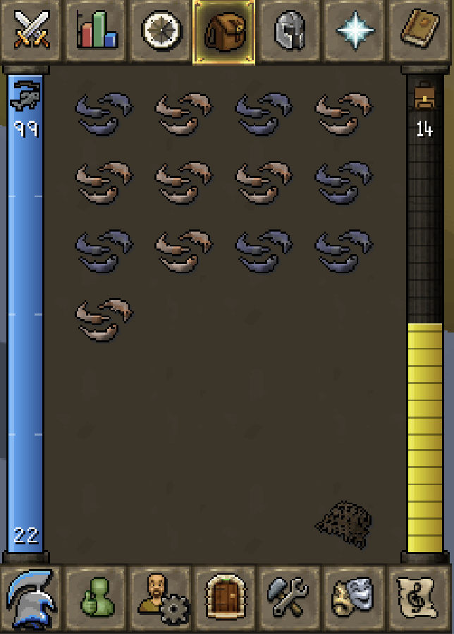
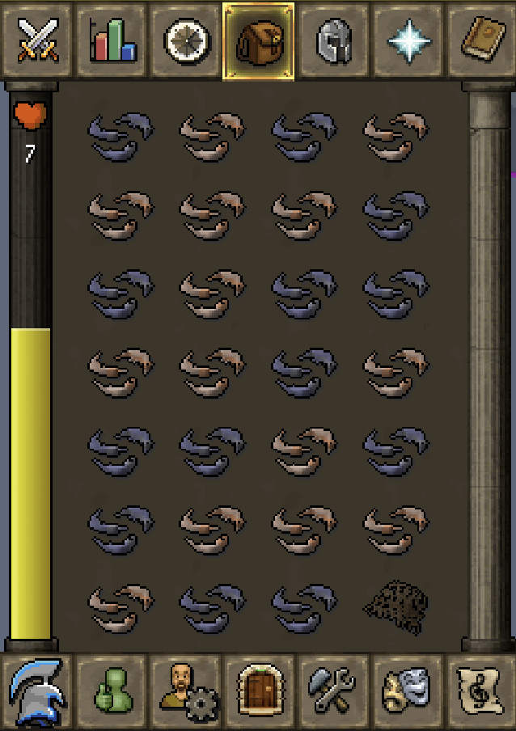
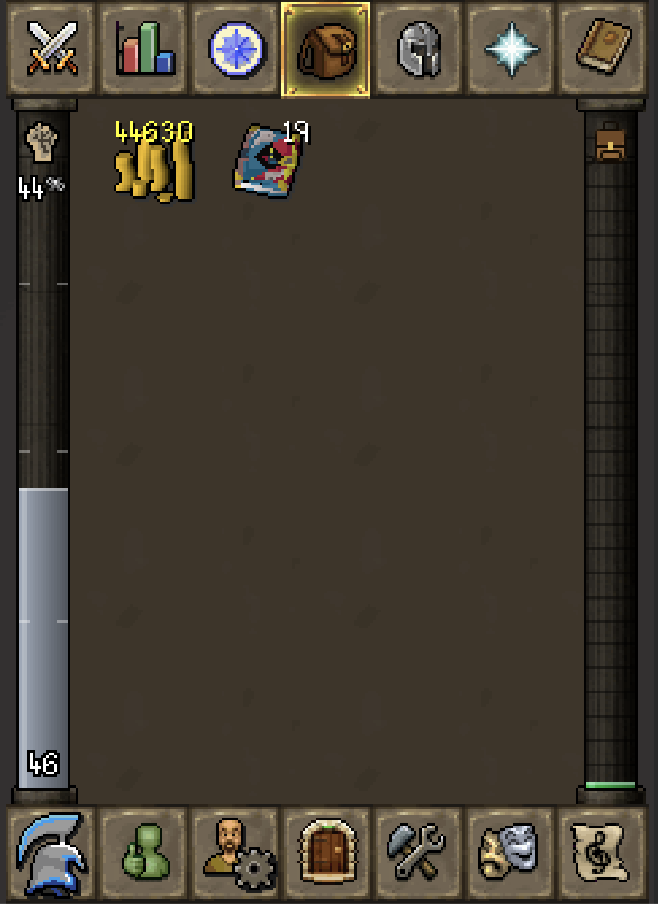
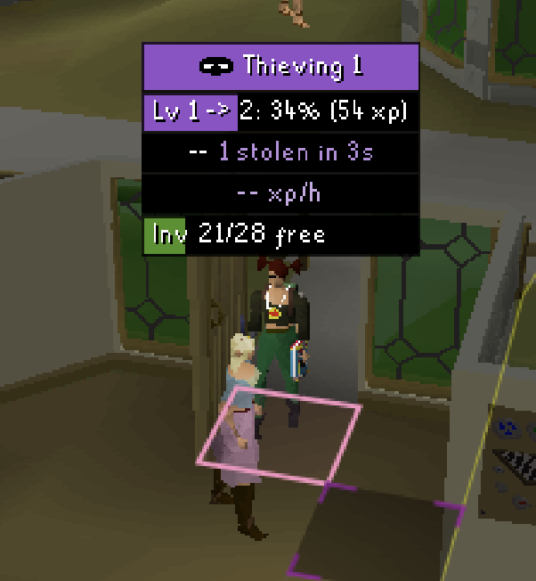
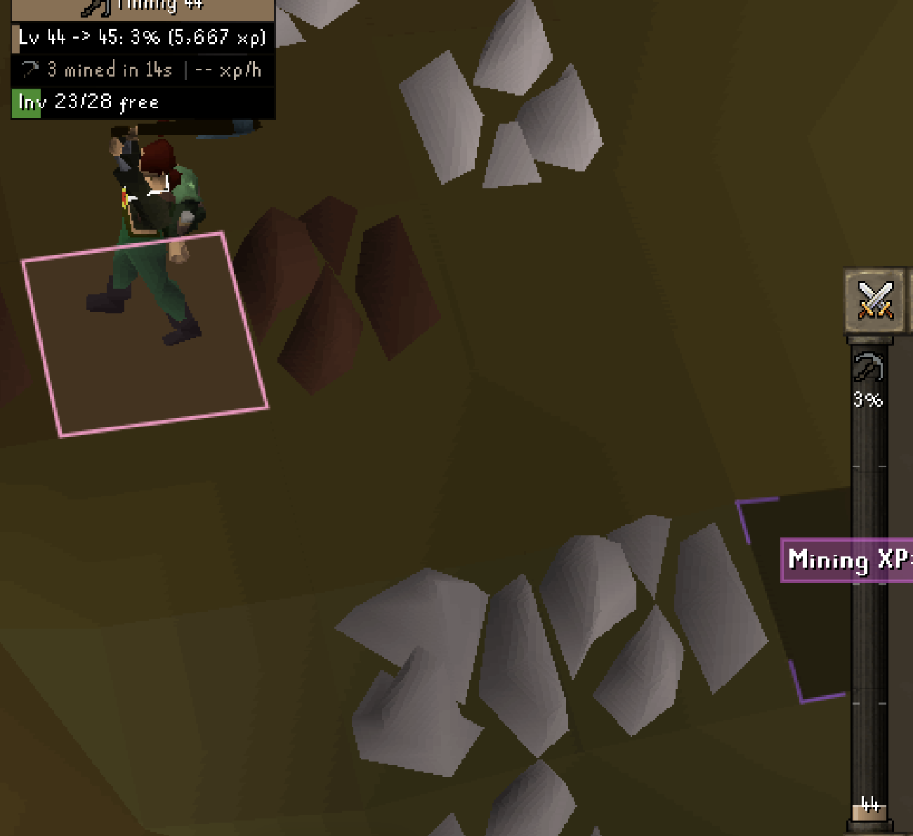
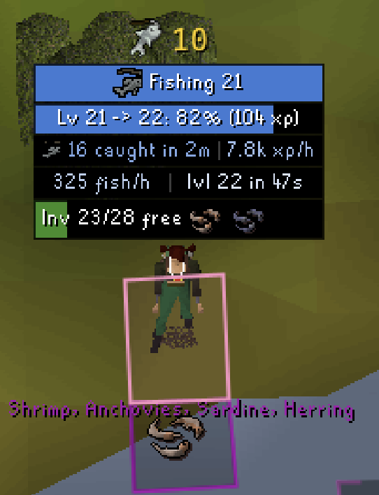

# What it does

Back to the [README](../README.md). Settings and defaults are in
[SETUP.md](../SETUP.md#settings).

## Which version has what

The Plugin Hub has **1.1.0** today, listed as *Combat Vitals*. Version 1.2.0 is
an open Plugin Hub pull request, and the rest is on `main` only. This page marks
each feature so you know what you can install:

| Mark | Meaning |
|---|---|
| *(no mark)* | In 1.1.0, installable from the Plugin Hub now. |
| **Coming in 1.2.0** | In the open 1.2.0 update. Not installable until it merges. |
| **After 1.2.0** | On `main` only (1.3.0 and newer). Not submitted to the Plugin Hub yet. |

The marks come from the config keys and source files at commit `9d7a168`
(2026-11-10, version 1.1.0), `68131b6` (version 1.2.0) and `a64d61a` (version
1.3.0). The exact commit the Plugin Hub built for 1.1.0 was not checked; the
[CHANGELOG](../CHANGELOG.md) has the full list.

## Covers these plugins

Everything runs in one matching style, and plays nicely if you keep any of these
enabled alongside it.

| Plugin | What Combat & Skilling Vitals covers |
|---|---|
| [NPC Health Text](https://runelite.net/plugin-hub/show/npc-health-text), [Monster HP Percentage](https://runelite.net/plugin-hub/show/monster-hp-percentage), [Custom HP Bar](https://runelite.net/plugin-hub/show/custom-hp-bar) | Overhead hitpoints, percentage, or both above NPC and PvP targets and your own character, with separate boss and high-HP rules, a three-stop colour fade and optional game health bar replacement. **After 1.2.0:** *Only after damage*. |
| [Inventory Notifier](https://runelite.net/plugin-hub/show/inventory-notifier), [Fish Barrel](https://runelite.net/plugin-hub/show/fish-barrel), [Log Basket](https://runelite.net/plugin-hub/show/log-basket) | Full-inventory alerts while gathering or thieving and a green-to-red inventory bar. **Coming in 1.2.0:** fish barrel and log basket tracking and a two-colour open-container pillar. **After 1.2.0:** log basket contents by item. |
| [CoalBag](https://github.com/WolffTech/coal-bag-plugin), [Essence Pouch Tracker](https://runelite.net/plugin-hub/show/essence-pouch-tracking), [GP Per Hour](https://runelite.net/plugin-hub/show/gp-per-hour) *(containers only)* | **Coming in 1.2.0:** coal bag fill (27, or 36 with a Smithing cape) and essence pouch fill with degraded capacities. Does not track GP profit. |
| [Forestry Tracker](https://runelite.net/plugin-hub/show/forestry-tracker), [Ent Trimmer](https://runelite.net/plugin-hub/show/ent-trimmer) | **Coming in 1.2.0:** Forestry event spawn alerts. **After 1.2.0:** post-event XP and reward summaries in chat, kit leaf counts, and solved-target outlines and labels for all nine events. |
| [Idle Alarm](https://runelite.net/plugin-hub/show/idle-alarm), [Instant Idle Notify](https://runelite.net/plugin-hub/show/instant-idle-notify), [AFK Countdown](https://runelite.net/plugin-hub/show/afk-countdown) | Stopped-gathering and stopped-thieving alerts. **Coming in 1.2.0:** repeating audio or spoken alarms that stop on a click, key press or XP, remaining production inputs and ETA, and the Blast Furnace pump idle-logout countdown. **After 1.2.0:** the same countdowns while splashing or at the Gemstone Crab. |
| [Clue Scroll Notifier](https://runelite.net/plugin-hub/show/clue-scroll-notifier), [Sound Alerts Expanded](https://runelite.net/plugin-hub/show/sound-alerts-expanded) | **Coming in 1.2.0:** clue drop alerts with tier, your own WAV files, three synthesised sound packs, offline voice lines and sidebar muting. |
| [Gemstone Crab](https://runelite.net/plugin-hub/show/gemstone-crab-timer), [Gemstone Crab Alert](https://runelite.net/plugin-hub/show/gemstone-crab-alert) | **After 1.2.0:** crab health %, burrow countdown, shell timer, cave outline and arrow, and spawn, burrow and cave-ready alerts. |
| [Remaining Casts](https://runelite.net/plugin-hub/show/remaining-casts), [Autocasting](https://runelite.net/plugin-hub/show/autocast-utilities) *(combat spells)* | **After 1.2.0:** active spell, rune icons and casts left, with a low-casts alert. No spellbook tooltips and no Lunar or Arceuus utility spells. |
| [XP Goalz](https://runelite.net/plugin-hub/show/xp-goalz), [Goal Tracker](https://runelite.net/plugin-hub/show/goal-tracker), [Daily Goals](https://runelite.net/plugin-hub/show/daily-goals) | **After 1.2.0:** per-account skill level, skill XP, boss kill, item, daily and weekly goals with ETAs and a *Goal reached* alert. |
| [Max Hit](https://runelite.net/plugin-hub/show/maxhitplugin), [Max Hit Calculator](https://runelite.net/plugin-hub/show/max-hit-calculator), [DPS Calculator](https://runelite.net/plugin-hub/show/dps-calculator) | **After 1.2.0:** a **Max Hit** sidebar tab with melee, ranged and magic max hit, hit chance, average damage and DPS from your gear and boosted stats. |

| Built-in plugin | How Combat & Skilling Vitals covers or works with it |
|---|---|
| **Opponent Information** | Corner target-health panel, single-opponent hitpoints lookup (with an opt-out) and PvP stat comparison. Hides its own corner panel while Opponent Information is on. |
| **NPC Aggression Timer** | **After 1.2.0:** a 10-minute unprovoked-aggression countdown and optional 21x21 ground lines. |
| **Status Bars** | Side pillars beside the inventory for target health, XP progress and inventory fill. They stack to the left of Status Bars so the bars never overlap. |
| **Boosts Information** | Preserve-aware boost drain timer, boost source and an optional boost-drop alert on the skilling badge. |
| **Idle Notifier, Item Charges & Random Events** | Stopped-gathering, spot-moved, stopped-thieving, make-X, low-run-energy and dodgy necklace alerts that stay quiet when you walk off, bank or drop items. **Coming in 1.2.0:** random event alerts and pump idle-logout alerts. |
| **Fishing, Woodcutting, Mining, Agility, Runecraft & XP Tracker** | Badge for fishing, woodcutting, mining, thieving, runecraft and hunter, with catchable fish icons. **Coming in 1.2.0:** eleven more skills, agility laps and marks, session totals. **After 1.2.0:** Forestry target solvers. |

## Combat

- **Target and own health readout:** health over whoever you fight, NPC or PvP
  player, and optionally in a corner box (*Show panel*). Your own exact
  Hitpoints from the orb show over your character while you are engaged (*Show
  your own health*, also while pickpocketing). *Bar behind text*, *Text above
  health bar* or *Text only*; *Top*, *Middle* or *Bottom* plus a pixel offset; a
  three-stop green-amber-red fade; a 1 to 60 second timeout after combat.
- **Bosses and regular monsters:** *Big targets* and *Other targets* show
  percentage on bosses and 200+ HP NPCs and hitpoints on everyday monsters. The
  readout stands down behind the game's boss health bar by default.
- **PvP lookups:** an optional single-target hiscores Hitpoints lookup (cached
  for an hour, falls back to percentage for unranked players) and a *Stat
  comparison panel*.
- **Game health bar and overhead chat:** *Hide game health bar* (off by
  default, [native-hp-bar.md](native-hp-bar.md)) swaps the game's bar for the
  readout and redraws plain bars for everyone else. *Chat above readout* (on by
  default, [overhead-chat.md](overhead-chat.md)) lifts overhead chat above the
  readout so talk is never covered.
- **How exact the number is:** the game sends opponent health as a bar ratio.
  NPCs with 30 max HP or less resolve to the exact hitpoint; higher-HP targets
  and players sit within a small band. Your own health is always exact. See
  [accuracy.md](accuracy.md).
- **Side pillars:** optional bars beside the inventory (*Status Bars* look or
  *Flat*): target health in combat, XP progress and inventory fill while
  skilling. **Coming in 1.2.0:** an open log basket or fish barrel merges into
  the inventory pillar as one two-colour bar.
- **After 1.2.0, *Only after damage*:** show the overhead readout only briefly
  after a hitsplat, like the game's own bar.
- **After 1.2.0, NPC aggression timer:** when an NPC turns on you unprovoked, a
  corner panel counts down ten minutes (`Aggressive for 9:54`). Leaving the
  21x21 area, hopping, changing floors or logging out resets it. *Aggression
  area lines* draw the boundary (off by default).
- **After 1.2.0, one combat card:** a single compact card carries these, so you
  never get several boxes:
  - **Casts left:** spell, rune icons with per-cast cost and casts remaining
    from inventory, rune pouch, combo runes, staves and charged fire or water
    tomes, with a low-casts alert.
  - **Splashing mode** ([splashing.md](splashing.md)) for AFK Magic: your Magic
    attack bonus and chance to hit, a logout clock, a casting clock, warnings
    ahead of the game's 20-minute no-input stop, and *Splash: setup broke*.
    *Auto-detect splashing* switches it on at a Magic bonus of -40 or lower.
  - **Gemstone Crab mode:** crab health %, a burrow countdown, the shell clock,
    a cave outline with an arrow, and spawn, burrow and cave-ready alerts.

  

| Skilling pillars | Combat pillar | XP pillar |
|:---:|:---:|:---:|
|  |  |  |

## Skilling

- **Skilling badge:** over your head, over the spot, tree or rock, or fixed on
  screen (Alt-drag to move). Fishing, woodcutting, mining, thieving, runecraft
  and hunter show boosted level, a Preserve-aware boost drain timer and source,
  tool special attack energy, XP progress, session count, XP/h, actions/h and
  time to level. When you stop it reads `Not fishing` for a while you choose.
  **Coming in 1.2.0:** Herblore, Cooking, Fletching, Crafting, Smithing,
  Firemaking, Prayer, Magic (skilling spells only), Agility (laps, lap time,
  marks of grace), Construction and Sailing, with remaining materials and ETA
  (`14 left, done in ~25s`).
- **Fishing:** icons for every fish the clicked method can land (higher-level
  fish dimmed or hidden), a `Needs: ...` flash when you click a spot without the
  right tool, bait or level, and a marker for the nearest active spot of the same
  kind with an optional **Shortest Path** route (*Next spot path*).
- **Inventory fill:** a green-to-red bar (`Inv 26/28 free`). Tools, bait, worn
  gear and stackables hold their slot without counting as filling.
- **Containers (coming in 1.2.0):** rows for a log or forestry basket, fish or
  fish sack barrel, coal bag and essence pouches. A container you have not
  checked reads `?/28`; the plugin never guesses. **After 1.2.0:** a checked log
  basket lists the logs inside it.
- **Blast Furnace pump (coming in 1.2.0):** a `Pumping (Blast Furnace)` badge
  with Strength XP, pump count, `AFK logout in`, `Pump stops in`, and checks for
  the wrong world, an unstoked stove (`Stove: no one stoking`) and coke running
  out.
- **After 1.2.0, sessions and events:** *Auto-reset on new activity*, a chat
  summary when a Forestry event ends, optional gem and clue bottle alerts, and
  *Idle pause (s)* so rates stop counting while you are away.
- **After 1.2.0, Forestry highlights:** outlines the solved target for each of
  the nine Forestry events with a short label (`Step here`, `Pair`, `1st`,
  `Anima root`, `Empty nest`, `Disarm`, `Stand under`, `Add logs`, `Prune ...`).
  Observation only. Not yet verified in game: the empty-nest test, the entling
  prune table, and the beebox and trap IDs.
- **After 1.2.0, Hunter:** missing impling net or jar is flagged on click.

| Thieving | Mining | Fishing catch list |
|:---:|:---:|:---:|
|  |  |  |

## Alerts, voice lines and muting

**In 1.1.0** (own switch each, follows your RuneLite notification settings):
Inventory full, Stopped gathering, Fishing spot moved, Stopped thieving,
Pickpocket stun (off by default), Coin pouches at cap, Dodgy necklace broke,
Make-X finished (off by default), Low run energy (off by default).

**Coming in 1.2.0:**

- **More alerts:** Stopped pumping, Idle logout soon, Pump stops soon, Wrong
  world, Stove: no one stoking, Stove: coke runs low, Bird nest, Clue drop (with
  tier), Forestry event, Pet, Level up (off by default) and Random event (off by
  default).
- **Sounds:** one shared profile with *Same for every alert*, or set each alert
  to RuneLite's sound, *Soft chime*, *Music box*, *Retro blip*, a **Voice line**
  (*"You've stopped chopping yew logs."*) or **My sounds**: your own WAV files
  in `.runelite/plugin-data/combat-vitals/sounds/`.
- **Repeat until you're back:** an alert can repeat every few seconds until you
  click, press a key, gain XP again, or hop or log out.

**After 1.2.0:**

- **Mute bar:** **Mute alerts** plus **15 min**, **30 min** and **60 min** at the
  top of the sidebar silence every alert, audio and on-screen.
- **Mute alert sounds** keeps notifications but silences the sound, and *Follow
  game volume* (off by default) scales plugin sounds with the game's sound
  effects slider.
- **New alerts:** Mining and fishing events, Goal reached, Splash: setup broke,
  Splash: stops soon, Splash: stopped, Casts: running low, and the three Crab
  alerts.

## Sidebar panel

**Coming in 1.2.0:** the plugin adds its own sidebar button (a health bar over a
skilling bar). The panel has a **Live** section with Hitpoints, Prayer, run and
spec, your target and your skilling badge readout; **Presets**; and five guided
settings tabs (**Combat**, **Targets**, **Skilling**, **Alerts**, **Look**) that
mirror RuneLite's settings list in both directions. Each tab opens with a short
guide you can hide with **Hide guides**. Walkthroughs for each tab are in
[SETUP.md](../SETUP.md#settings-tabs-walkthroughs).

**After 1.2.0:** the panel grows to six tabs (**Live**, **Goals**, **Max Hit**,
**Overlays**, **Presets**, **Settings**). **Live** switches between **Combat**,
**Skilling** and **Overall** views and shows a *Run on/off* chip. **Goals** keeps
per-account goals. **Max Hit** calculates melee, ranged and magic max hit and
DPS. **Overlays** has a switch per overlay with **Show every overlay** and
**Hide every overlay**.

### Presets (coming in 1.2.0)

A preset only changes the few settings it lists. Click one to see what would
change, then Apply; Undo puts those settings back.

| Preset | What it sets |
|---|---|
| Skiller | Skilling vitals and the skilling badge on, skilling side pillars, every alert as a Voice line that repeats until you are back |
| PvM | Combat vitals on: readout over the target, the panel, your own health, NPC targets, the stat comparison, the combat side pillar |
| Minimal | Just the health bar over your target: no panel, no own health, no stat comparison, no side pillars, Skilling vitals off |
| Everything | Both halves on: readout, panel, your own health, the stat comparison, the skilling badge, both side pillars |
